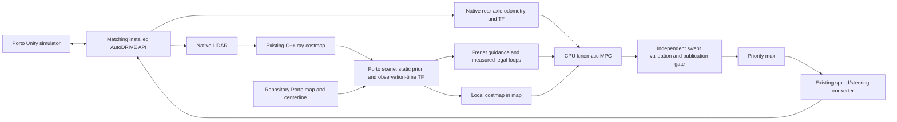

# MPC in the installed Porto AutoDRIVE simulator

This integration is on `feature/mpc-autodrive`. It targets the **installed Porto scene**, as selected after inspecting the running simulator. Mexico City references do not match its geometry or starting pose.

## Run

Dependencies from [install-mpc-dependencies.sh](install-mpc-dependencies.sh) remain under `$HOME/.local/opt/wato-mpc`. ROS Jazzy, the mux dependencies, NumPy, and OpenCV are installed on the tested Ubuntu 24.04 WSL host. Use the system Python for ROS.

From the repository root:

```bash
# Once, or after source/config changes:
bash documentation/run-mpc-autodrive.sh build

# Start the matching installed API container:
bash documentation/run-mpc-autodrive.sh api

# Start the controller stack; it starts disabled:
bash documentation/run-mpc-autodrive.sh run
```

Open `C:\Users\what\Downloads\autodrive_simulator\sim.exe`, connect to `127.0.0.1:4567`, and select **Autonomous**. A simulator **Reset disconnects the API**; reconnect afterward. Wait for telemetry before enabling. The script does not launch or control the Windows UI.

In a second terminal, choose one:

```bash
# Bounded trial: records telemetry, disables afterward, checks measured stopping,
# checks collision count, continued progress, and at least one native lap:
bash documentation/run-mpc-autodrive.sh trial --seconds 180 --require-laps 1 \
  --output log-autodrive/my-trial.json

# Or continuous driving. Ctrl-C removes the enable heartbeat:
bash documentation/run-mpc-autodrive.sh drive
```

Run only one enable publisher. The controller expires its heartbeat after 150 ms; the converter also clears stale selected requests after 60 ms. Emergency, joystick, and keyboard retain higher mux priority. An API connection or Unity-mode failure cannot be repaired by ROS command publication alone. Use the simulator's manual controls/reset when necessary.

`MPC_CONFIG` selects a **generated build-time solver profile**. The commands file selects `config/autodrive.json`; the launch requires `model_profile=autodrive` and rejects another compiled profile. Rebuild all workspace consumers of `global_planner/ReferenceTrack` after the message extension. No physical-car launch is supplied.

### Change the speed

Edit `src/robot/mpc_controller/config/autodrive.json`:

```json
"speed_cap": 1.0,
"target_speed_mps": 0.4
```

Both values are in m/s. `target_speed_mps` is reference guidance; `speed_cap` is the hard requested-speed limit. The target must be finite, nonnegative, and no greater than the cap. Stop the driving publisher and controller launch, run `bash documentation/run-mpc-autodrive.sh build`, then restart `run` and `drive`. The scene reads the installed config at startup; file edits do not change a running controller. The recorded lap test used a target of 0.4 m/s.

## What runs



The API container uses its existing Humble installation; host nodes use Jazzy. Host DDS uses the committed UDP-only profile because shared-memory discovery succeeded but message delivery failed across Docker/WSL. UDP telemetry and command delivery were exercised locally. This does not establish compatibility for arbitrary ROS versions or other API images.

The commands file uses ROS domain 0, matching the installed API. Do not run another autonomy stack publishing the same command topics in that domain.

The pinned local API image is `sha256:86084593df851c02494745215a12b546f58d94dee4e4e075f884547216abf6fc`. Its source lives inside `/home/autodrive_devkit/src/autodrive_devkit/autodrive_roboracer/`. Despite the `autodrive_f1tenth:latest` tag, its bridge uses vector `V1 Linear Velocity`, gzip LiDAR, and native odometry. The downloaded official 2025 API instead expected `V1 Speed` and failed against this installed simulator. The commands file uses the working image; it does not change its source or silently download a different release.

### Track, states, and geometry

- Guidance starts from `global_planner/assets/my_map_clean.csv` and `particle_filter/maps/porto.pgm`. At startup, a bounded normal search shifts the existing guide toward mapped clearance; periodic averaging removes pixel-scale offsets. It is converted from body-center guidance to rear-axle guidance and reduced to 147 points. This is a provisional map-specific guide, not a newly optimized racing line.
- The existing periodic cubic Frenet reference still uses cumulative **straight segment lengths** as its station parameter, with its existing metric, projection association, and lap wrapping. Cartesian optimizer states remain at the rear axle. Speed guidance is initially **0.4 m/s**, with a hard requested-speed cap of 1 m/s.
- Local reference extraction uses a cubic Hermite lateral-offset join over at least 1.2 m, preserving the measured initial offset and heading before merging into guidance. This avoids demanding an immediate lateral jump at the first reference sample. It is still checked against the original geometry and may be rejected when a forward-only rejoin is infeasible.
- Two free-space contours from the PGM provide explicit legal boundary loops (304 and 188 vertices). They are implicitly closed, in `map`, and validated for simple/disjoint/nested topology. Original map cells independently remain collision inputs. Width values are approximate guidance after recentering; they do not define Porto's legal annulus. Existing references with empty loops retain the width-offset behavior.
- `map -> world` is identity for these matched assets. Native odometry is `world -> roboracer_1`, with `roboracer_1` at the rear axle. The bridge's native `roboracer_1 -> lidar` transform is used; there is no second publisher for that child frame. These frame/extrinsic choices were inspected in the installed API and checked against live geometry. They are not physical-car calibration.
- The installed vehicle rests with about 0.031 rad of tilt. This profile permits at most 0.04 rad total tilt; larger tilt and invalid transforms reject. Flattening a unit-rotation transform over the local grid's roughly 3.35 m radius loses at most about 2.7 mm horizontally at that bound, before other map/model errors. The generic controller default remains 0.01 rad.
- Body extents remain front 0.45 m, rear 0.15 m, half-width 0.14 m. A circle of radius `hypot(0.30,0.14)` ≈0.331 m, centered 0.15 m ahead of the rear axle, covers the full rectangle at every heading. Solver faces constrain that yaw-dependent center. This removes unnecessary rear-centered-circle conservatism without shrinking the modeled vehicle. Swept checking includes the disk center's motion due to heading changes.

### Static prior and live obstacles

The C++ ray costmap has 160×120 cells at 0.025 m resolution: 3 m forward, 1 m behind, and 1.5 m each side. Porto's 5 cm PGM has 0 occupied, 205 unknown, and 254 free pixels. Its YAML's `free_thresh: 0.25` would classify 205 as free; this profile explicitly retains those pixels as unknown.

`porto_scene.py` transforms the local grid at its **original observation timestamp** and conservatively samples every overlapping static-map cell. Mapped walls cannot be erased by ray tracing or self filtering. Live occupied cells override mapped free space. Known static free space fills the LiDAR's rear blind region; it is a map prior, **not newly observed free space**. Unknown space remains blocked unless live rays observed it free; legal track boundaries still apply. The assumption is a matched, static track with live observed obstacles, not unseen moving opponents.

The API stamps TF just before the scan, so an exact-time lookup can initially require a future TF sample. Both stages defer bounded pending observations instead of using latest TF or restamping them. Queues hold at most four inputs and expire them after 150 ms. Missing/expired input ultimately inhibits commands through the controller's existing freshness gates. The prior adapter caps grids at 200×200 cells and 0.01–0.025 m resolution; overflow/malformed data reject.

Full-cell disk inflation supplies the usual fast safe mask. Near cell boundaries it can reject a continuously safe pose. The fallback certifies a small box using distance to **original occupied/unknown cell squares and legal boundary segments**, capped by the distance actually searched. The distance function is 1-Lipschitz in disk-center translation, so a box with half-size `(clearance_distance - required_clearance)/sqrt(2)` retains the required clearance throughout. This is a conservative certificate, not free-space clearing. The independent trajectory validator remains mandatory.

The existing single bounded A* repair is retained for static obstacles. Very narrow passages or unreachable forward-only poses can produce a safe stop. No opponent tracking, background maneuver search, actuator-state dynamics, delay compensation, or GPU implementation was added.

### Solver and commands

The provisional configured wheelbase is 0.3302 m, close to the inspected API's 0.33 m front-wheel transform; it has not been identified from vehicle data. Requested steering limits are explicitly ±0.5236 rad for this simulator. The physical-car profile retains its servo-derived bounds. These are build-time profiles, not runtime model substitution.

The solver performs up to three RTI linearizations, stopping early when inequality and per-stage dynamics residuals are at most `1e-6`. Final acceptance still uses the independent analytic rollout, original geometry, between-stage allowance, request-rate bounds, terminal stop request, freshness, deadline, input versions, and manual/emergency ownership. No residual or collision threshold was relaxed. Cold starts use a braking speed rollout with steering guidance; failed solves reset solver state. Numerical face tightening is at most 2 mm and at most half the seed slack, so it cannot exclude a valid stopped seed merely because it sits close to a face.

The inherited converter uses `throttle = requested_speed / 22.88` and `normalized_steering = steering_rad / 0.5236`. This is **not physical instantaneous speed control**. The MPC deliberately retains the requested instantaneous bicycle assumption; actual speed/yaw errors, scan/state age, and command delivery delay remain model errors. The bounded trial records native odometry and selected commands so these errors and stopping can be measured. Zero throttle is only an idle request until an actual moving-stop test establishes behavior for the tested scene and speed.

The inspected API rounds normalized commands to 0.001. Under the bridge's nominal conversion, half a quantization step corresponds to about 0.0114 m/s requested-speed error and 0.000262 rad steering error, before actuator and model errors. The optimizer does not model this extra quantization; the live results are evidence for the tested low-speed case, not a physical safety certificate.

## Validation and limits

Automated checks cover both generated profiles, full-body circle coverage, measured-loop topology, unknown/wall preservation, rotated conservative map sampling, tilt rejection, continuous certificates near cell edges, seed-feasible tightening, analytic swept collision rejection, static detours, stale inputs, enable expiry, paused/rewound clocks, manual/emergency arbitration, and stalled solving. Run:

```bash
source /opt/ros/jazzy/setup.bash
source install-ros/setup.bash
build-ros/mpc_controller/mpc_tests
python3 src/robot/mpc_controller/test/test_porto_scene.py
FASTRTPS_DEFAULT_PROFILES_FILE="$PWD/src/robot/mpc_controller/config/fastdds_udp.xml" \
  python3 src/robot/mpc_controller/test/test_runtime.py
```

Raw trial artifacts are written under ignored `log-autodrive/`; the trial requires native collision/lap telemetry, movement, continued end-of-run progress, the requested lap count, and measured stopping. Status notification counts can exceed rejected cycle counts because a stop and its final status both publish notifications.

### Live result, 2026-10-14

The final 180 s trial started from a reset Porto scene and passed `--require-laps 1`. Host: Intel i9-13980HX, x86-64 Ubuntu 24.04 under WSL2; Unity renderer and matching Docker API running. Artifact: `log-autodrive/porto-trial-5.json`; additional geometry analysis: `log-autodrive/porto-trial-5-analysis.json`.

| Measurement | Result |
|---|---:|
| Native lap counter | 0 → 1, then continued into the next lap |
| Native collision counter | 0 → 0 |
| Travel including stopping | 50.18 m |
| Approved optimizations / collected cycles | 8,717 / 9,179, including four disabled seconds at the end |
| Controller release-through-publication elapsed, p50 / p95 / p99 / max | 1.364 / 2.926 / 3.397 / 4.636 ms |
| Collected cycles over 20 ms | 0 |
| Minimum validated predicted disk clearance | 0.0798 m |
| Independent actual disk clearance against static map/loops | 0.0797 m minimum |
| Distance to sampled rear-axle guidance polyline, p50 / p95 / max | 0.0269 / 0.1320 / 0.1681 m |
| State observation age, p50 / p95 | 29.1 / 53.1 ms |
| Grid observation age, p50 / p95 | 87.2 / 112.2 ms |
| Native odometry period, p50 / p99 | 52.3 / 60.8 ms |
| Maximum requested / native measured speed | 0.444 / 0.464 m/s |
| Measured speed at disable | 0.329 m/s |
| Time after disable to measured speed ≤0.02 m/s | 0.220 s; remained stopped through the final check |

The geometry analysis uses native recorded poses, the full body-covering circle, original static cell squares, and extracted boundary segments. Guidance distance uses the sampled polyline, not exact spline projection. Both depend on the provisional body dimensions and map alignment. No physical-car stopping result is implied.

The elapsed metric includes controller scene construction, problem preparation, solver update/solve/extraction, independent validation, and command/path/status publication calls. It excludes upstream ray tracing/prior fusion, DDS delivery, mux transit, and simulator application. Observation-age measurements expose part of that upstream delay. **These results do not prove a complete sensor-to-applied-command cycle under 20 ms**: the native simulator supplies only about 19 Hz observations here, and exact-time TF deferral adds roughly a source period to grid availability. The controller still schedules optimization every 20 ms on the latest sufficiently fresh input. Publication-gate rejections were retained when versions changed during a solve.

The final source passed 17 C++ tests for each generated profile, four Python scene checks, and five ROS integration checks. The ROS fixture smoke sample approved 98/100 collected cycles, with p99 7.93 ms and maximum 8.04 ms; controller, mux, and fixture RSS totaled about 97.4 MiB. A separate post-trial RSS sample for controller, costmap, prior adapter, mux, and converter totaled about 301.5 MiB, excluding the launch process, static TF process, API, and Unity. These short host samples are not thermal or Orin benchmarks.

These are host functional measurements with the Unity renderer/API running. They do not establish Jetson Orin timing, thermal behavior, memory under the full autonomy stack, worst-case latency, physical-car parameters, braking performance, or collision avoidance for unobserved moving objects. The native simulator input rate must also be measured: a 50 Hz optimization timer does not create new 50 Hz sensor observations. Collision-counter telemetry is useful evidence, not a proof for all scenes.
