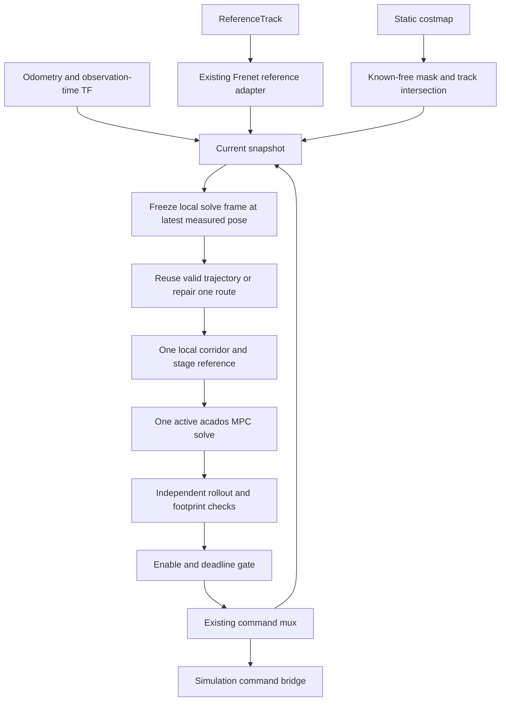

# MPC prototype implementation plan

Prepared: 2026-10-13.

Implementation status: the CPU prototype is available on `feature/mpc-prototype`; see [run instructions](../src/robot/mpc_controller/README.md) and [validation results](mpc-prototype-results.md). The design record below describes the agreed plan before implementation.

Original status: draft for implementation. This document records the agreed prototype scope and proposed engineering defaults. No controller code, solver installation, simulation run, or hardware benchmark was performed to produce it.

## 1. Confirmed scope

Build a small CPU MPC prototype that follows the raceline, can detour around static costmap obstacles, and publishes speed and steering commands through the existing command interface.

The user confirmed:

- Include static costmap obstacles.
- Use Cartesian optimizer states with the existing Frenet track/reference representation.
- Solve in a car-aligned local frame frozen for each control cycle, while retaining the costmap in its original grid coordinates.
- Initialize directly from the most recent valid state snapshot, without state-age or command-latency compensation, extra filtering, interpolation, or extrapolation of that state.
- Start with offline tests and simulation.
- Use a simple kinematic bicycle model.
- Assume speed and steering commands act instantaneously in the prediction model.
- Use the inspected physical command path's asymmetric steering-request bounds: approximately `[-0.308199, +0.268644]` rad, derived from the servo conversion and clipping limits below.
- Use deterministic state and geometry inputs; do not add covariance, confidence probabilities, chance constraints, or uncertainty-value/inflation parameters. Geometric clearance and numerical/raster tolerances remain ordinary deterministic settings.
- Do not implement background maneuver proposals or opponent tracking.

Keep the existing cumulative straight-segment-length progress coordinate. Reuse the periodic cubic reference geometry; do not reparameterize it by spline arc length or replace it with new geometry for this prototype.

The inherited runtime target remains one fresh optimization and validated command every 20 ms. This is a benchmark target, not an established capability. There is no required race speed; in particular, 10 m/s is not a requirement.

Out of scope: moving-object prediction, multiple passing candidates, background search, actuator lag/dead-time identification or compensation, dynamic tire models, GPU backends, solver comparisons, production safety guarantees, and physical-car trials. These exclusions deliberately narrow the larger [MPCC plan](mpcc-implementation-plan.md).

## 2. Repository baseline and reuse

The current checkout is `mpc` at `85326f44d5fc4dcb2a0d4cc8c67c04bd35a2ac8f`. The inspected reference is local `origin/frenet-stateful-on-orin` at `c3b40e25d0c1845bc0e99e5529208bd7eca665c6`. Inspection used `git show`; the reference branch was not checked out. Source inspection does not establish deployed behavior.

For the future implementation, use an isolated implementation branch/worktree based on the Frenet reference revision so that `local_planning_core` and `ReferenceTrack` can be linked directly. Bring across the small simulation bridge from the current checkout as needed. This plan does not authorize or perform a branch switch now.

| Existing component | Use in this prototype | Required qualification |
|---|---|---|
| `local_planning::RacelineReference` | Projection, spline samples, tangent/normal, curvature, speed guidance, wrapping and width lookup | Chord-length station is not exact spline arc length. Preserve `parameter_speed` where converting station increments to distance. |
| `global_planner/ReferenceTrack` | Map-frame raceline and index-aligned left/right widths | Use a reference and widths belonging to the simulation map. The current checkout's legacy path alone has no widths. |
| `local_planning_core` export | Link reusable reference/geometry utilities | Do not run the old maneuver planner or state machine in the MPC launch. |
| Existing EDT/collision helpers | Reuse their useful primitives and tests after checking assumptions | Sampled center checks are not sufficient to establish whole-footprint clearance between stages. |
| Existing track-bounds checker | Reference behavior/tests only | It skips checks where the footprint is observed in the grid and checks lateral station bounds rather than unconditional full-footprint containment. It is not the prototype's final validator. |
| `/drive/autonomy` to mux to `/ackermann_cmd` | MPC output and selected-command observation | Only one autonomy controller may publish. Give manual/emergency ownership explicit behavior. |
| `main`/`mpc` `sim_util` | AutoDRIVE sensors and command bridge | Absent from the inspected Frenet branch. Integrate explicitly; do not assume that branch has a working simulation launch. |

Do not copy `force_dead_man_active: true` or permissive unknown/out-of-grid policies. The prototype deliberately adopts the steering-request range derived from the physical driver's configuration; it does not adopt the controller's wider `±0.52` rad clamp or treat configured values as measured mechanical limits.

Pinned evidence: [reference API](https://github.com/WATonomous/wato_f1tenth/blob/c3b40e25d0c1845bc0e99e5529208bd7eca665c6/src/robot/local_planning/include/local_planning/reference/raceline_reference.hpp), [track message](https://github.com/WATonomous/wato_f1tenth/blob/c3b40e25d0c1845bc0e99e5529208bd7eca665c6/src/robot/global_planner/msg/ReferenceTrack.msg), [track checker](https://github.com/WATonomous/wato_f1tenth/blob/c3b40e25d0c1845bc0e99e5529208bd7eca665c6/src/robot/local_planning/src/collision/track_bounds_checker.cpp), [existing planner configuration](https://github.com/WATonomous/wato_f1tenth/blob/c3b40e25d0c1845bc0e99e5529208bd7eca665c6/src/robot/local_planning/config/local_planner.yaml).

## 3. Small architecture

Create one `src/robot/mpc_controller/` ROS 2 package with a ROS-independent core and one runtime node. Link the existing reference library. Use Python/CasADi only for offline solver generation and experiments; call the generated acados C solver from C++.

Internal responsibilities are ordinary functions: reference preparation, static environment/seed preparation, solving, validation, and ROS scheduling. Do not add a plugin system, universal model expression layer, background worker, or separate ROS node for each responsibility.

The local route is an initialization and constraint-preparation aid. MPC selects speed and steering and produces the executable trajectory. Only its first validated command is published.

## 4. Decisions and rationale

| Decision | Problem and alternative | Recommendation and limit | Acceptance evidence |
|---|---|---|---|
| One CPU backend | Avoid spending prototype effort on backend portability; standalone QP assembly would require custom nonlinear machinery | Use acados SQP-RTI/HPIPM. Retain plain numerical input/output types, but no second backend implementation | Generated solver builds, agrees with independent rollout, and meets measured complete-cycle timing |
| Existing Frenet reference with Cartesian dynamics | Need current geometry without Frenet model singularities or a geometry rewrite | Keep the existing spline/station. Extract Cartesian stage references outside the solver | Seam/hairpin association and reference fixture tests pass; solver never treats station differences as exact spline distance |
| Frozen local solve frame and native grid | Avoid full-grid reprojection and keep solver positions near the origin; a map-frame solve with transformed grid queries is also viable | Transform only local reference samples, corridor faces and warm starts into a car-aligned frame fixed during the solve | Coordinate-equivalence tests pass; benchmark total preparation rather than claiming local coordinates inherently accelerate optimization |
| Latest-state initialization | Keep the prototype's input path small; forward propagation could compensate measurement/computation age | Use the most recent valid state unchanged apart from coordinate/reference-point conversion; preserve timestamps and freshness checks | Initial pose exactly matches the selected observation after rigid conversion; log age and resulting tracking/clearance error |
| Direct speed/steering controls | Match available command fields under the user's instantaneous-response assumption; acceleration/steering-rate control would need a response model | Optimize speed and steering. Any request-change limits are command regularity limits, not an actuator model | Offline plant matches the assumed commands; simulator mismatch is measured and reported |
| Physical-path steering bounds | Avoid predicting turns that the inspected servo driver would clip; the controller's `±0.52` rad ceiling is wider | Use the asymmetric interval derived from `servo = -1.2135 * steering + 0.476` and servo limits `[0.15, 0.85]` in the optimizer and validator | Boundary tests agree with the conversion; no accepted request would be clipped under that configuration |
| One deterministic route when blocked | A raceline seed can pass through a static obstacle and cause a local optimizer to fail; multiple pass candidates are out of scope | Reuse a validated shifted solution. If blocked, perform one bounded synchronous grid search for one detour | A static blocked-raceline scene produces a valid detour when this pipeline finds one; search timeout produces a recorded fallback |
| Conservative center corridor | Avoid a grid lookup/nonlinear distance constraint inside every solver evaluation | Inflate occupied/unknown/illegal space by a circumscribed vehicle radius plus clearance, then build axis-aligned rectangles entirely inside remaining free space | Independent footprint checks find no clearance or track violations; document narrow passages rejected by inflation |
| Fixed horizon and arrays | Bound memory and per-cycle numerical work | Start with 30 intervals of 40 ms, 1.2 s lookahead, updated every 20 ms | Benchmark this configuration before varying one horizon/integration setting at a time |

The grid search chooses one local route, not a set of maneuver proposals. It does not run asynchronously and does not compare left/right optimized candidates. This prototype does not establish globally optimal obstacle avoidance or the full MPCC architecture.

Official acados documentation supports code generation, parameter updates, nonlinear least-squares costs, RTI and structured QP options. These features motivate the backend choice; they do not establish Orin latency. [acados Python/code-generation interface](https://docs.acados.org/python_interface/index.html), [acados features](https://docs.acados.org/features/index.html).

## 5. Reference and static environment preparation

### Latest-state snapshot and solve frame

- Select the most recent valid localization/odometry state available at cycle start and freeze it for that cycle. Retain the source observation and receipt times; creating a snapshot does not make the observation newer.
- Do not advance the measured state to cycle start, solver completion or expected command application. Do not add state filtering, interpolate state samples to a common time, or reconstruct an initial state by replaying old commands. Existing upstream localization remains the state source.
- Keep coordinate conversion separate from time compensation: use the observation-time transform to express the measured pose in `map` and convert its pose reference point to the rear axle. These rigid conversions do not advance the state in time. Reject a missing transform rather than falling back to latest TF.
- Let the converted measured rear-axle pose be $(p_0,\psi_0)$. Define one local solve frame there, aligned with its heading, and hold that frame fixed for the entire prediction horizon. The initial physical state is exactly $(0,0,0)$ in that frame; this does not assert that the actual car has remained there while computation runs.
- Convert map-frame points and headings using $p^{local}=R(-\psi_0)(p^{map}-p_0)$ and $\psi^{local}=\psi^{map}-\psi_0$, with consistent heading unwrapping. The bicycle predicts future motion through this fixed frame; it is not a frame that follows the predicted car.
- Retain the complete solve-frame transform and observation timestamp with the cycle and result. A previous warm-start trajectory must be rigidly converted from its old solve frame into the new one.
- Keep the costmap at its own observation-time pose. Compute the transform between native grid coordinates and the solve frame once per cycle; transform queries or corridor faces, not every grid cell. An older grid must not be reattached to the latest car pose.
- Measured speed is the latest available received value, with its own age if separately sourced. Use it for diagnostics and seed/reference initialization without predicting a newer speed. Reject required stale inputs; no extra synchronization estimator is introduced.

MPC still predicts future motion from the selected measured state. Shifting a previous command sequence to prepare a warm start is allowed; it must never replace or advance the measured initial state.

### Reference

- Subscribe to `ReferenceTrack`; validate sizes, finite values, frames, positive widths and map identity.
- Preserve `sampleAtS`, `project`, `wrapS`, `rawBounds` and `parameter_speed` through a thin adapter.
- Maintain caller-owned unwrapped station and projection seed. Wrap only for reference lookup.
- Use previous station, heading and plausible displacement to reject projection jumps at hairpins and the lap seam.
- Sample only the required local route/heading targets from the map-frame Frenet reference, then transform those samples into the frozen solve frame. Do not transform or refit the whole raceline. If sampling by physical distance, advance station using the spline metric or numerical curve sampling; do not equate chord station with spline arc length.
- A changed reference resets association and warm starts. Geometry replacement later stays behind the adapter.

### Costmap and legal space

- Treat occupied, unknown and out-of-grid cells as unavailable. Keep this policy identical in seeding, constraints and validation.
- Preserve scan observation time upstream and use the corresponding transform. No latest-TF fallback that silently changes the observation time.
- Keep the grid in its original orientation and transform queries; avoid the existing nearest-cell map reprojection as a supposedly conservative obstacle representation.
- Build a conservative legal-track mask from the reference widths, with explicit map alignment and rasterization margins. Widths remain provisional geometry; test reconstructed boundaries on the selected map.
- Intersect known-free space with legal-track space before footprint inflation. Observed free cells must never override track limits.
- Use one immutable static snapshot per cycle. All occupied cells are assumed stationary for that snapshot's bounded validity interval. There are no object IDs, tracks or prediction arrays.
- Reject missing/stale grids and malformed sizes. Bound grid capacity explicitly; do not crop away obstacles that the checked trajectory could reach.

### One seed and corridor

1. Resample the previous accepted command sequence forward by the actual elapsed time and roll it out from the latest measured pose, with no propagation of that initial pose. Convert any reused state trajectory to the new solve frame. Reuse the seed only after checking the latest grid and track.
2. Otherwise try the forward raceline segment. If blocked, select one forward raceline goal inside observed/legal space and run one deterministic bounded A* search on the inflated grid. Do not allow diagonal corner cutting.
3. Limit search expansions and elapsed time. Exceeding either bound returns `NoSeed`; it does not prove no feasible route exists.
4. Resample the single route into stage positions and unwrapped headings. Build finite rectangles aligned with the native grid axes around its samples. Rectangles must lie entirely inside the certified free-cell union, including cell-edge margins.
5. Transform stage targets and each rectangle's four half-planes into the frozen solve frame. Rotated rectangles still use four faces; do not replace them with larger axis-aligned bounding boxes that could include obstacles. Give the optimizer one rectangle per stage and check connecting motion independently; endpoint containment alone is insufficient.

No new smoothing library is needed. If the raw grid route has corners a bounded-curvature bicycle cannot traverse, the solver may smooth it inside the corridor or reject it. The prototype may stop in feasible scenes where its one route/corridor is inadequate; log that limitation rather than claiming infeasibility of the environment.

## 6. Model and representative optimization

Use the rear-axle reference point, with an explicit transform from the simulator's pose reference point. Optimizer positions and unwrapped headings are in the frozen local solve frame. The master Frenet reference and external trajectory visualization remain in `map`; the costmap remains in its native grid. All solver references, constraints and warm starts use the same cycle-local frame.

Physical state and input:

$$
z=[X,Y,\psi],\qquad u=[v^{cmd},\delta^{cmd}].
$$

Instantaneous-command kinematic bicycle:

$$
\dot X=v^{cmd}\cos\psi,\qquad
\dot Y=v^{cmd}\sin\psi,\qquad
\dot\psi=\frac{v^{cmd}}{L}\tan\delta^{cmd}.
$$

There is no predicted speed state, steering-response state, acceleration input, command delay or actuator lag. Measured speed is retained for diagnostics, initialization and detecting mismatch, not mislabeled as a predicted actuator state.

Use an explicit RK4 discrete map $z_{k+1}=F_{\Delta t}(z_k,u_k)$. With a zero-order-held input, an independent analytic constant-curvature rollout can serve as the test/validation oracle, handling the straight-line limit without division by zero.

For adjacent-request penalties and bounds, augment the numerical state with $q=[v_{prev}^{cmd},\delta_{prev}^{cmd}]$ and update $q_{k+1}=u_k$. The solver therefore has `nx=5`, `nu=2`; the additional two values are command memory, not vehicle dynamics. Initialize memory from the last mux-selected autonomy request. Reset on takeover or history loss.

For the single route's stage target $p_k^r$, heading $\psi_k^r$, and speed guidance $v_k^r$, minimize:

$$
J=\sum_{k=0}^{N-1}\Delta t_k
\left[
\|D_p^{-1}(p_k-p_k^r)\|_Q^2
+q_\psi\left(\frac{\psi_k-\psi_k^r}{\psi_*}\right)^2
+q_v\left(\frac{v_k^{cmd}-v_k^r}{v_*}\right)^2
+\left\|D_{\dot u}^{-1}\frac{u_k-q_k}{h_k}\right\|_R^2
\right]+\Phi(z_N).
$$

Use the measured interval since the previous selected request for $h_0$ and planned command intervals afterward. Reference headings are unwrapped consistently with the state. Weights and scales are documented preferences. This is reference-tracking MPC with static local route preparation, not a virtual-progress or minimum-lap-time formulation.

Hard constraints:

- Latest measured pose fixed at stage zero, expressed as $(0,0,0)$ in the frozen solve frame, without time compensation.
- `0 <= speed_cmd <= configured_sim_speed_cap` and the asymmetric steering bounds derived below.
- Configured request-change limits; do not describe them as identified acceleration/braking capability.
- Rear-axle center in each stage's footprint-inflated corridor: $A_kp_k\le b_k$.
- Finite, valid bounds and compatible initial corridor.
- A zero final-interval speed request, giving a stationary terminal state under the assumed model. The terminal position has a soft target inside the corridor, not a mandatory unreachable goal.

Use nonlinear least-squares costs with Gauss-Newton approximation and one RTI step per normal cycle. Compare against a bounded higher-effort SQP solve offline to diagnose convergence. Cold initialization must complete while autonomy is disabled; do not add an unbounded recovery solve to the feedback loop.

Use the physical command path's steering conversion and driver limits:

$$
servo=-1.2135\,\delta^{cmd}+0.476,\qquad 0.15\le servo\le0.85.
$$

Because the conversion gain is negative, the steering-request bounds are:

$$
\delta_{\min}=\frac{0.85-0.476}{-1.2135}\approx-0.308199\ \mathrm{rad},\qquad
\delta_{\max}=\frac{0.15-0.476}{-1.2135}\approx+0.268644\ \mathrm{rad}.
$$

Store the bounds from these expressions in one configuration shared by problem preparation and validation. Do not substitute a symmetric `±0.52` rad limit. These are software request bounds from the inspected [VESC configuration](https://github.com/WATonomous/wato_f1tenth/blob/c3b40e25d0c1845bc0e99e5529208bd7eca665c6/src/robot/bringup_robot/config/vesc.yaml), not measured mechanical steering stops.

Apply the same request interval in simulation. Keep the simulator bridge's angle-normalization scale separate: do not change that scale to the new steering bound, which would remap an angle to a different simulated command. Enforce the bounds inside optimization and validation rather than clipping an accepted command afterward.

Start with a provisional 1 m/s simulation speed cap and geometry matching the selected simulator car. Wheelbase, footprint, simulator steering scale, geometric clearance and request-rate limits must be explicit fixture/configuration values. The converter's `max_speed=22.88` does not establish a real vehicle speed limit. No statistical uncertainty values are part of this prototype.

## 7. Minimal interfaces

Use plain structs/arrays, one persistent workspace, and no implementation-independent expression framework. Illustrative shapes use `N=30` and four rectangle faces.

| Value | Fields / shape | Ownership and validity |
|---|---|---|
| `ReferenceAdapter` | Existing reference handle, track version, projection seed and unwrapped station | Startup/reference-update owned; replacement resets warm start |
| `EgoSnapshot` | pose `[3]`, measured speed, observation and receipt times, pose frame | Immutable cycle input; reject stale/nonfinite or unavailable observation-time transform |
| `SolveFrame` | map-frame rear-axle origin `[2]`, yaw scalar, source observation time and cycle ID | Defined from the selected measured pose; fixed throughout one solve and retained with its result |
| `StaticScene` | occupancy `[rows,cols]`, grid origin/orientation, resolution, legal/free masks, observation time, expiry, scene version | Immutable prepared buffer; query in original grid coordinates |
| `CycleProblem` | initial numerical state `[5]`, stage targets `[31,3]`, speed targets `[30]`, normals `[31,4,2]`, offsets `[31,4]`, bounds, timestamps, versions and `SolveFrame` | Exclusively owned by the active solver; all geometry in its frozen local frame; finite corridor bounds only |
| `SolveResult` | numerical states `[31,5]`, requests `[30,2]`, status, raw residuals, iteration counts, solve duration and `SolveFrame` | Candidate in the recorded local frame; solver success does not imply acceptance |
| `ValidationResult` | accepted flag, reason, minimum clearance, boundary/rollout defect, checked interval, expiry | Required before publication |
| `CycleRecord` | input ages, seed/corridor status, per-stage timings, outcome and command sequence ID | Bounded log buffer; publication does not block on visualization |

ROS inputs are `ReferenceTrack`, `/odom` for simulation, observation-time TF, `/costmap`, an explicit enable/dead-man signal and `/ackermann_cmd`. Output is `AckermannDriveStamped` on `/drive/autonomy`, plus bounded-rate diagnostics and predicted-path visualization.

## 8. Validation and failure behavior

Before a command is eligible for publication:

1. Check input ages, enable/mode, versions, array sizes, finite values, solver residuals and total deadline.
2. Independently roll out commands from the selected latest-state snapshot in its frozen frame and compare with optimizer states. Do not advance or alter that snapshot to compensate for time spent solving.
3. Transform trajectory/footprint queries into the native grid and map as needed, and check original occupied/unknown cells and unconditional track boundaries, including motion between stages. Use subdivision with translation/rotation bounds and explicit numerical/raster error allowances. Transform only the small trajectory/constraint data; never resample the costmap for validation.
4. Check the first request against limits and the last selected request. Do not silently clip it after validation.
5. Confirm the modeled terminal stop remains inside checked free/legal space.

The instant-command model predicts instant speed changes; a zero final speed is only a model stop. It does not certify real braking or AutoDRIVE deceleration. Request-rate bounds improve regularity but do not repair this modeling limitation.

Latest-state initialization intentionally leaves observation age and computation/transport latency uncompensated. Keep age/deadline checks and log these quantities; neither the local-frame conversion nor future MPC rollout removes this initial-state timing error. Reject a result that exceeds configured freshness/deadline limits instead of adjusting its initial state after the solve.

On stale inputs, association failure, no seed/corridor, failed validation, solver error, or missed deadline: mark the cycle unsuccessful, issue the configured zero-speed simulation stop request, and keep it distinct from a successful optimized command. Verify actual stopping in AutoDRIVE before obstacle trials; if the bridge cannot provide a reliable stop, use simulation pause/reset as the test abort and do not report a physical stopping guarantee.

Do not automatically switch to pure pursuit around obstacles on MPC failure. Do not republish an old moving command as a successful cycle. Manual/emergency takeover overrides autonomy. A stalled solver must not prevent the command watchdog from executing.

## 9. Runtime budget hypothesis

All allocations occur at startup or bounded scene updates. Build/generate the solver before operation. Cache immutable track/grid preparation where valid. The active cycle performs one solver call, with no background candidate workspace.

| Complete-cycle work | Initial hypothesis |
|---|---:|
| Latest snapshot, ages, TF/projection and local-frame conversion | 1 ms |
| Scene update, seed repair and corridor preparation | 4 ms |
| Solver preparation and RTI feedback | 8 ms |
| Independent validation | 3 ms |
| Command gate/publication/mux path | 1 ms |
| Reserve | 3 ms |
| Total | 20 ms |

Count full-grid preprocessing and any synchronous A* repair, even when they happen only on some cycles. They are not free because their inputs are cached in other cycles. If those updates exceed budget, return a timely fallback and record a missed fresh-optimization cycle. Do not hide difficult scenes by measuring only warm solves.

Measure release-to-mux publication with a monotonic clock and observation-to-command age separately. A 50 Hz timer alone is not proof of 50 Hz feedback optimization. A hard interruptible solver is not assumed; discard late results by cycle ID, and keep the watchdog independent of the blocked solver's callback/workspace.

## 10. Ordered implementation tasks

The checkboxes below are the task list for this prototype; no separate tracker or duplicate plan is required.

### 1. Establish the implementation baseline and offline fixtures

- [ ] Build the chosen Frenet baseline and reusable core in the implementation environment; record revision, compiler and ROS versions.
- [ ] Add a small `mpc_controller` package skeleton and deterministic reference/occupancy fixtures: straight, curve, lap seam, static block with a detour, and fully blocked track.
- [ ] Record simulator wheelbase, pose reference point, footprint and provisional speed/request-rate limits in one configuration; derive the fixed asymmetric steering bounds from the physical-path conversion above.

Dependencies: none. Likely files: package metadata/build file, fixture data and configuration. Acceptance: existing focused reference tests pass and fixtures have known frames, boundaries, expected free regions and command units. Verification: Release build and focused `local_planning` reference tests; this must be executed during implementation, not assumed from source.

### 2. Prove the instantaneous model and generated solver path

- [ ] Implement the Cartesian bicycle and command-memory transition in CasADi, and generate one acados solver.
- [ ] Add independent analytic rollout tests for straight travel, constant steering, zero speed and command changes, plus acceptance/rejection tests at and outside both asymmetric steering bounds.
- [ ] Solve a no-obstacle fixture from a fresh state and decode commands/residuals.

Dependencies: 1. Likely files: generator, solver wrapper and model tests. Acceptance: over the configured low-speed envelope, prediction agrees with analytic rollout within 1 mm position and 0.001 rad heading over the selected horizon; invalid/nonfinite inputs are rejected. Verification: focused tests and standalone Release solver timing, including wrapper overhead.

### 3. Connect the existing Frenet reference

- [ ] Add the thin adapter and seeded, unwrapped station handling.
- [ ] Extract local Cartesian stage targets and capped speed guidance using the existing spline metric; transform only the sampled targets into the cycle's frozen frame.
- [ ] Reset association/warm starts on reference replacement or relocalization faults.

Dependencies: 1–2. Likely files: reference adapter, problem preparation and reference tests. Acceptance: seam traversal is continuous, hairpin projection does not jump branches, and spline station is not treated as exact arc length. Rigidly transformed reference/trajectory fixtures agree between map and solve frames, including reuse of a previous cycle's warm start. Verification: offline closed-loop solo fixture and existing/extended reference tests.

Checkpoint A: one generated solver and one model follow an empty-track reference offline; no obstacle-avoidance or timing claims yet.

### 4. Prepare static free space and one detour corridor

- [ ] Add original-grid querying, age/frame validation, legal-track intersection and conservative footprint inflation.
- [ ] Reuse a valid shifted seed; add one bounded A* repair for blocked seeds with no diagonal corner cutting.
- [ ] Build one sequence of grid-aligned safe rectangles and transform their four faces into the solve frame, with explicit capacity and failure results.

Dependencies: 3. Likely files: static-scene preparation, seed/corridor helper and tests. Acceptance: known blocked cells/unknown space are never certified free; the detour fixture produces a route; a blocked track, insufficient capacity or search timeout returns a recorded failure. Verification: deterministic cell-edge, rotated-grid, narrow-gap and obstacle-route tests.

### 5. Constrain MPC and validate its trajectories

- [ ] Add corridor, command/request-change and modeled terminal-stop constraints.
- [ ] Add independent original-scene footprint/swept-motion checks and rollout-defect checks.
- [ ] Reject solver success with invalid trajectory, wrong version or exceeded deadline.

Dependencies: 2–4. Likely files: formulation, validator and scenario tests. Acceptance: complete the static-detour fixture without collision/boundary violations; reject an injected between-stage collision; stop in the assumed model when no valid route is available. Verification: closed-loop offline scenarios and bounded higher-effort SQP comparison for failed RTI cases.

Checkpoint B: static obstacle avoidance works offline through one route/corridor and one active MPC; no background proposals or opponent tracking exist.

### 6. Integrate timestamp-aware ROS inputs

- [ ] Add the node, immutable latest-state snapshot handling with no time adjustment, explicit enable input and selected-command observation; freeze the local frame at that measured pose.
- [ ] Preserve scan-time costmap stamps and observation-time transforms upstream; do not inherit latest-TF fallback.
- [ ] Add cycle IDs, command gate, timeout/watchdog behavior and bounded diagnostics.

Dependencies: 5. Likely files: node/input adapter, costmap timestamp fix and integration tests. Acceptance: stale/future-inconsistent inputs, missing TF, disable, takeover and late results cannot publish an approved moving command. A valid delayed state is used exactly as received after rigid conversion, and an older grid remains at its observation-time pose. Verification: ROS integration tests with delayed/missing inputs, frame round trips and an intentionally stalled solve.

### 7. Wire the simulation launch and stop behavior

- [ ] Bring `sim_util` into the implementation branch where needed and provide a map-matched `ReferenceTrack` fixture/publisher.
- [ ] Add a prototype launch with only MPC publishing autonomy; give manual/emergency commands explicit priority over autonomy.
- [ ] Check command units and actual AutoDRIVE stop response; keep the instantaneous MPC model unchanged and report mismatch.

Dependencies: 6. Likely files: simulation bridge integration, dedicated bringup launch/mux configuration and reference fixture. Acceptance: no old planner/pure-pursuit autonomy publisher runs; manual/emergency override and test abort work; low-speed solo and static-detour scenes are repeatable. Verification: live topic inspection and simulator ground-truth recordings. If physical stopping cannot be verified, use pause/reset for test abort and mark command-stop behavior unresolved.

### 8. Benchmark and close the prototype

- [ ] Run the same solo, static-detour, fully blocked, seam and stale-input scenes with timestamps and ground truth.
- [ ] Measure full-cycle latency, memory, valid-command rate, clearance, tracking, interventions and mismatch under the rest of the simulation/autonomy workload.
- [ ] Record passed gates, failed scenes and minimal next changes; do not add excluded architecture to rescue the benchmark.

Dependencies: 7. Likely files: replay/benchmark runner, scenario definitions and result report. Acceptance: the completion checks below have measured outcomes; unresolved performance or model limitations remain explicit. Verification: at least 10,000 cycles for a development run, and 100,000 cycles with thermal/shared-load evidence before claiming target-computer 50 Hz operation.

## 11. Completion checks and benchmark protocol

- Offline matching-model tests and simulation solo/static-detour scenarios pass without collision or track-boundary violation. Check full footprint and inter-stage motion against independent scene ground truth.
- Every accepted trajectory meets configured clearance after numerical/raster allowances. No collision or legal-track slack is accepted.
- Failed-search, blocked-track, stale-input, relocalization, takeover, solver-failure and late-result tests exercise the intended failure path.
- Report raceline error on solo segments and route error through detours separately; legitimate obstacle avoidance should not count as failed raceline tracking. Record RMS/max error, completion time, minimum clearance, request variation and stop/intervention counts.
- Report p50/p95/p99/p99.9/max complete-cycle latency, misses, longest miss burst, solver-only timing, grid/search update timing, memory and input age. Include failed/rejected cycles in the population.
- Initial timing acceptance hypothesis: p99.9 below 18 ms and no observed release-to-mux publication above 20 ms in the nominal benchmark. A fallback or old-command publication is not a fresh MPC success. Failure to meet this gate means the 50 Hz target remains unmet.
- Keep desktop simulation results separate from Jetson Orin results. If Orin is unavailable, finish the functional prototype and explicitly leave the target-hardware timing gate unverified.
- For Orin evaluation, record software versions, power mode, cooling, temperature, clocks, thermal throttling and perception/localization freshness. Test with that workload active; no GPU work is introduced by this prototype.

## 12. Known limits and later changes

The single conservative corridor can reject feasible narrow detours or select a route that a bicycle cannot traverse. This is a recorded prototype limit, not a reason to add background candidate search now.

The instantaneous-command model intentionally omits actual steering/propulsion response and delay. AutoDRIVE's inspected bridge converts the requested speed to normalized throttle, so numerical MPC speed and simulated physical speed need not match. Measure the mismatch; do not treat successful idealized tests as evidence of physical-car readiness.

Using the latest state without adjustment also omits motion between observation and command application. Measure this timing error separately from model mismatch. Adding state-age propagation or latency compensation later is a deliberate extension, not part of this prototype.

The reference adapter leaves room for better geometry later without rewriting command/runtime code. A future actuator or velocity-state model will change model/solver dimensions and require regeneration and warm-start reset. Neither extension is implemented for this prototype.

The prototype is complete when its scoped functionality and measured limitations are documented. Physical deployment, dynamic opponents and the larger MPCC architecture require separate work.
