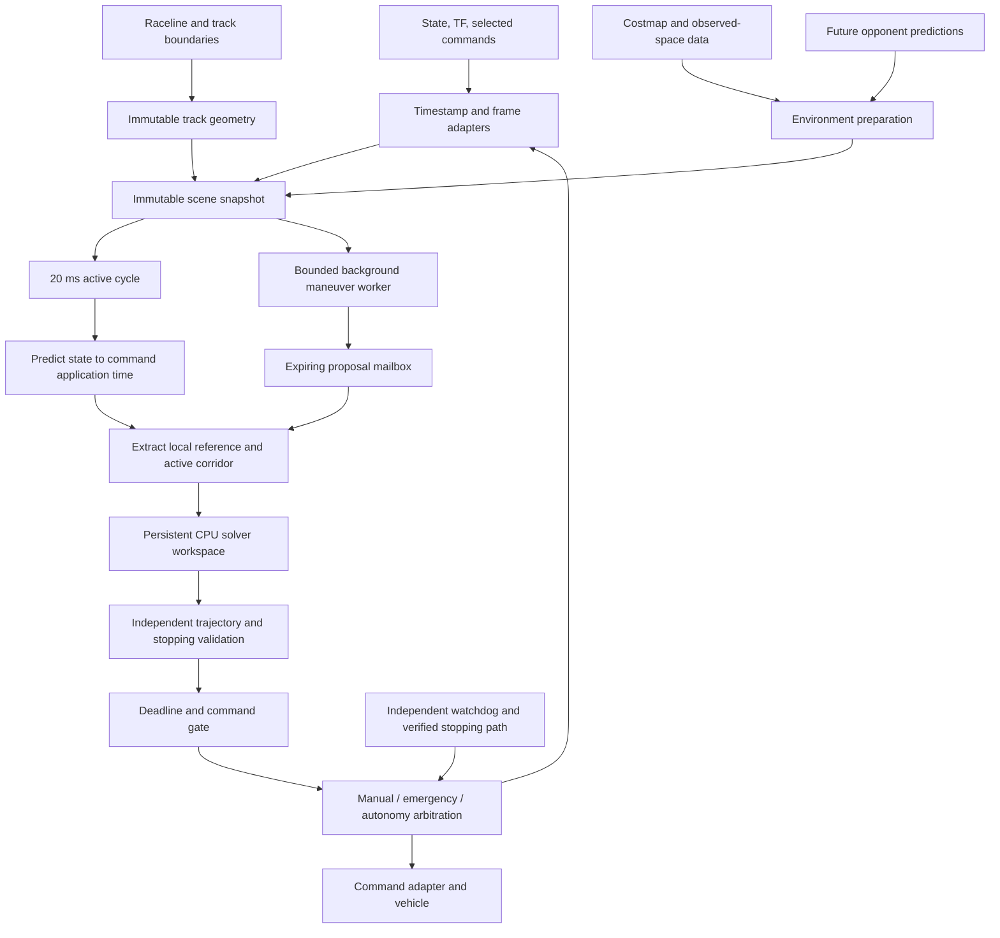

# Modular MPCC implementation plan

Prepared: 2026-10-12.

Status: proposed architecture, interfaces, and validation plan. No controller implementation, deployment verification, or hardware benchmark was performed while preparing this plan.

## Recommendation and repository evidence

I recommend a **CPU-first, Cartesian MPCC runtime using acados as the first backend to benchmark**, with compact per-stage geometry, explicit actuator and timing models, independent trajectory validation, and slower exploration of distinct maneuvers. Keep TurboMPC behind the same application contract and evaluate it on identical problems before selecting it for CPU or GPU operation.

The main optimization should be **reducing the work presented to the solver**: prepare geometry outside optimization, keep constraints local and bounded, preserve optimal-control sparsity, and reuse allocated workspaces. None of this establishes that the complete system will meet 20 ms on the shared Orin; that remains an acceptance test.

The inspection covered all four requested documents, the working `main` revision `4aa2c4a`, and local `origin/frenet-stateful-on-orin` at `c3b40e25d0c1845bc0e99e5529208bd7eca665c6` using `git show`. No branch switch or source modification was made during the investigation.

**The repository establishes several important interface facts, but no deployed-performance evidence.**

The [conversation record](mpcc-conversation.md) and subsequent requirements supersede the [older tracking-MPC plan](mpc-implementation-plan.md). In particular, use a 20 ms complete-cycle target, include environmental constraints from the first formulation, and do not adopt zero-speed publication as a verified stopping strategy. The [capability map](../MPCC-CAPABILITY-MAP.md) is a useful responsibility map, but its nested vectors, generic descriptors, and status names need tightening for the fast loop. The [repository overview](repository-overview.md) provides the current package and launch context.

| Inspected evidence | Consequence for this plan |
|---|---|
| `main` publishes raceline speed in `Path.position.z`; pure pursuit uses a 50 ms timer. | Decode the legacy representation at the adapter. Neither the timer nor encoded speed defines the new controller’s operating envelope. |
| The costmap is 20 × 20 m at 0.05 m resolution, initialized as unknown, stamped at publication, and uses latest TF with a possible 100 ms wait. | Preserve scan observation time and acquisition interval upstream. Never perform that blocking TF lookup in the control cycle. |
| The physical Ackermann converter consumes speed and steering, mapping them to ERPM and servo position; it ignores acceleration fields. | Optimize requests the interface can execute. An acceleration-controlled model would otherwise predict a different plant. |
| VESC servo “sensor” output is the clipped command. Odometry can calculate yaw rate from that command. | Neither signal independently validates actual steering response. Avoid circular system identification. |
| VESC telemetry polling uses a 20 ms timer and host receipt timestamps. | This proves polling intent, not acquisition time, delivery rate, or fresh physical feedback every cycle. |
| Driver brake-current commands exist separately; normal zero-speed commands request zero ERPM. | Verify stopping through the selected command mode and firmware configuration. |
| The inspected emergency node publishes reduced/zero Ackermann speed. | Existing emergency-topic wiring is not evidence of physical braking. |
| Manual and autonomy mux inputs have equal configured priority. | Add explicit mode ownership and takeover behavior; test actual tie/timeout behavior. |
| PF launch does not launch the configured smoother; the other inspected launch constructs it without adding it. | Do not model smoothing merely because its YAML parameters exist. |
| Reference branch has periodic cubic geometry, seeded projection, width lookup, and an EDT collision checker. | Evaluate these implementations and tests for reuse instead of starting geometry utilities from scratch. |

Physical-interface evidence is in the pinned [Ackermann converter](https://github.com/WATonomous/wato_f1tenth/blob/c3b40e25d0c1845bc0e99e5529208bd7eca665c6/src/robot/vesc/vesc_ackermann/src/ackermann_to_vesc.cpp), [VESC driver](https://github.com/WATonomous/wato_f1tenth/blob/c3b40e25d0c1845bc0e99e5529208bd7eca665c6/src/robot/vesc/vesc_driver/src/vesc_driver.cpp), and [emergency node](https://github.com/WATonomous/wato_f1tenth/blob/c3b40e25d0c1845bc0e99e5529208bd7eca665c6/src/robot/safety_system/src/ebreak.cpp). These are inspected source behaviors, not confirmation of the installed hardware, running nodes, firmware settings, or deployed revision.

## Architecture and data flow

**Use one planning-and-control package with a small number of internal boundaries.**

A proposed `src/robot/mpcc_controller/` package should contain a ROS-independent core, a thin ROS adapter/runtime, backend-specific formulation adapters, and replay tests. Python is appropriate for CasADi generation, JAX experiments, and analysis; the first active runtime should call generated C from C++.

Keep these as functions/data structures where possible:

- **Scene preparation:** timestamp alignment, immutable track/environment versions, progress association.
- **Problem preparation and solving:** active maneuver, model variant, native backend workspace.
- **Validation and runtime:** acceptance, deadlines, handover, publication.
- **Background proposals:** separate workspace and bounded mailbox.
- **Evaluation:** the same core called without ROS.

The existing safety path should remain independently schedulable if the optimizer stalls. This is a justified process boundary; track geometry, costs, and vehicle dynamics do not each need a node.

This arrangement reduces serialization and allocation while allowing backend replacement. It gives up arbitrary runtime plugin loading and live model swapping during a lap. Confirm it through allocation profiling, integration complexity, and full-cycle timing; introduce more process boundaries only for demonstrated isolation needs.

## Representation choices

**Choose representations that make the active optimization small and predictable.**

The following recommendations are engineering choices to test, not measured performance conclusions.

| Choice and problem addressed | Credible alternatives | Recommendation and rationale | What it gives up; evidence that would overturn it |
|---|---|---|---|
| **Vehicle coordinates:** easy obstacle geometry without repeated projection | Fully Cartesian; fully Frenet; combined | Cartesian vehicle pose/velocity plus one progress coordinate. Cartesian footprints match grids and object predictions; progress supports raceline costs and association. | More state than a minimal Frenet model. Compare derivative cost, conditioning, projection failures, and solve acceptance on hairpins and large offsets. |
| **Master reference:** smooth geometry and derivatives | Polyline; periodic cubic spline; higher-order piecewise polynomials | Reuse the branch’s periodic cubic approach after validation. Keep original boundary geometry separately. | Cubics can overshoot noisy points; third derivatives need not be continuous. Reject fits exceeding geometry/error budgets. Higher order is justified only by measured derivative or fit problems. |
| **Geometry inside the solve:** avoid global lookup and branching | Full spline evaluation; affine stage approximation; local polynomial | Extract fixed-size local cubic windows with validity intervals. Compare an affine cost/reference variant as the cheaper alternative. | Restricts each iteration to trusted local windows. Benchmark preparation plus solving, not solver time alone; retain full-spline evaluation if approximation rejection dominates. |
| **Track authority:** avoid confusing guidance with legality | Raceline tube; full legal track; exact speed tracking | Raceline is soft guidance; authoritative boundaries constrain legal space. Speed guidance is optional feedforward/preference, capped by measured limits and stopping visibility. | May depart substantially from the raceline. Team preference could tighten this, but should not silently become a safety constraint. |
| **Static environment:** preserve evidence while reducing constraints | Raw grid constraints; distance field; polygon obstacles; corridors | Retain grid/unknown masks as validation truth. Build an EDT and conservative local corridors outside the solve. | Corridor construction can exclude usable space. Compare conservatism, corridor failure rate, preprocessing tails, and achieved clearance. |
| **Opponent footprint:** smooth, bounded constraint count | One circle; multiple circles; ellipse; oriented box/polygon | Store physical box/polygon dimensions; use a certified two-circle cover for the first solver variant. | Circle unions over-cover corners/sides. Use boxes or separating planes if conservative blockage materially increases following/interventions. |
| **Moving obstacles:** preserve timing and uncertainty | Frozen grid; constant-velocity prediction; multimodal predictions | Time-indexed occupancy tubes, initially from synthetic/basic predictions or conservative motion envelopes. Preserve uncertainty semantics. | Conservative envelopes can prevent passing. Upgrade prediction when measured coverage and usefulness justify it. |
| **Maneuver constraints:** preserve distinct passing choices | Different seeds alone; direct constraints; corridors; mixed integer optimization | Corridor/side constraints for maneuver identity, with direct moving-object constraints where needed. | Fixed maneuver topology can reject an otherwise feasible escape. Background exploration and a stopping contingency address this; measure missed feasible opportunities. |
| **Vehicle dynamics:** balance identification and computation | Kinematic bicycle; dynamic bicycle; blended model | Kinematic bicycle with identified speed/steering response first, within a measured envelope; dynamic bicycle as the first alternate. | Kinematic model omits slip and transient lateral dynamics. Held-out prediction error and intervention rates determine promotion. |
| **Grid/horizon:** useful lookahead without excessive stages | Fine uniform grid; coarse uniform grid; nonuniform grid | First benchmark: 30 × 40 ms = 1.2 s; also test a same-duration grid refined near the present. Feedback remains 20 ms. | Coarser far stages can miss motion unless checked between stages. Stopping feasibility and inter-stage error determine acceptable grids. |
| **Numeric precision:** stable baseline before acceleration | FP64; FP32; mixed precision | FP64 reference/CPU baseline; FP32 GPU variant only after residual and closed-loop equivalence tests. | FP64 may cost GPU throughput. Measured full-cycle benefit and clearance/feasibility differences decide. |

The established MPCC implementation by Liniger uses contour/lag errors, progress reward, approximate track half-spaces, and obstacle-avoidance corridors. That supports investigating these representations, without proving this design’s rate or safety. A separate research paper explicitly investigates combined Frenet–Cartesian representations. [MPCC source and formulation](https://github.com/alexliniger/MPCC), [Frenet–Cartesian research](https://arxiv.org/abs/2212.13115).

### Track and reference preparation

**Track preparation needs an explicit parameterization contract.**

The reference branch’s spline parameter accumulates waypoint chord lengths. Its implementation computes `parameter_speed = ||dr/dσ||`; therefore, `σ` is not automatically exact arc length. Preserve this metric or build an arc-length lookup at startup. Do not assume `dr/dσ` has unit norm. [Inspected reference implementation](https://github.com/WATonomous/wato_f1tenth/blob/c3b40e25d0c1845bc0e99e5529208bd7eca665c6/src/robot/local_planning/src/reference/raceline_reference.cpp).

At track load:

1. Validate finite points, duplicate/seam handling, positive widths, direction, frame, and boundary provenance.
2. Build periodic geometry, derivative coefficients, curvature, and a monotonic arc-length map.
3. Validate boundary construction independently. Raceline-normal widths do not automatically form a valid legal polygon near sharp turns.
4. Precompute overlapping local polynomial windows and bound position, tangent, curvature, and arc-length approximation errors.
5. Build a spatial index for startup/relocalization; use a bounded local search in normal operation.

Maintain **unwrapped progress** for lap continuity; wrap only when indexing immutable track data. Seed projection using previous progress, predicted travel, heading, and localization uncertainty. Nearby branches at hairpins must remain distinguishable. A failed local projection must raise an association fault; a global nearest-point fallback must not silently award a lap or jump to another branch.

For each cycle, select reference windows using the time-shifted previous trajectory. A window is valid only within its certified progress interval and lateral operating tube. If the optimizer leaves that domain, the result is rejected or re-prepared within the remaining budget—not accepted using extrapolated geometry.

### Environment and opponents

**Environment preparation must preserve distinctions that a single costmap cannot provide.**

Maintain separate layers for:

- Authoritative static geometry and legal boundaries.
- Recently observed free space.
- Unknown or unobserved space.
- Unclassified occupied cells.
- Tracked moving objects and their predicted occupancy.

A distance field is an acceleration structure, not new evidence of free space. Unknown space must have its own policy and age. For the initial bounded operating domain, recommend treating unknown/out-of-grid space as unavailable to the committed motion and stopping trajectory. This is conservative and may limit speed; it is preferable to silently asserting unseen track is empty.

For a grid spacing $h$, distance measured between cell centers differs from distance to occupied cell squares. Query rounding adds further error. If both occupied-cell extent and nearest-query-cell error are involved, a conservative correction can require up to $\sqrt{2}h$, before other margins. Validate the actual lookup implementation rather than copying a half-cell correction blindly.

The existing EDT checker is useful precedent, but its sampled path checks are not a continuous-motion certificate. In particular, center displacement alone does not bound corner motion during rotation. [Inspected checker](https://github.com/WATonomous/wato_f1tenth/blob/c3b40e25d0c1845bc0e99e5529208bd7eca665c6/src/robot/local_planning/src/collision/collision_checker.cpp).

For object selection:

- Broad-phase against a conservative ego reachable tube over the horizon **and stopping extension**, including vehicle extent, delay, state uncertainty, and opponent motion bounds.
- Keep objects whose occupancy tubes can intersect it.
- Record why each excluded object cannot intersect; nearest-$K$ distance ranking alone is insufficient.
- If relevant objects exceed capacity, conservatively aggregate them, restrict the reachable region/speed, or enter contingency. Never truncate silently.

For replacing a tracked object’s grid footprint:

1. Clear only cells with explicit ownership/provenance attributable to that object.
2. Preserve static occupancy and mixed/unattributed cells.
3. Require prediction coverage from the grid observation time through the entire requested prediction interval, including timestamp uncertainty.
4. Replace grid ownership and prediction coverage atomically in one environment version.
5. On expiry or track loss, retain an expanding reachable occupancy envelope or require new free-space evidence.

The current unlabeled costmap cannot support reliable selective clearing by itself. Until provenance exists, retain ambiguous occupancy. This can block a valid pass, but deleting it could leave a collision gap.

## Proposed interfaces and array shapes

**Use bounded arrays inside the runtime and richer messages only at the edges.**

The following are proposed contracts, not implementation code.

Conventions:

- Public geometry: metres in `map`; body geometry: a named, calibrated vehicle frame.
- An optional local solve frame is a rigid transform fixed for one cycle, recorded with the result.
- Angles: radians; velocity: m/s; acceleration: m/s²; curvature: 1/m.
- Observation/application times: signed 64-bit ROS nanoseconds plus clock epoch.
- Deadlines and durations: monotonic clock; never subtract ROS and steady timestamps.
- Floating-point solver arrays: FP64 initially, contiguous stage-major layout.
- Missing measurements use validity flags, never a default zero.
- Every buffer has capacity, active count/mask, version, source times, and expiry where applicable.

Illustrative capacities are $N=30$ intervals, $O=8$ relevant opponents, $H=8$ corridor faces per slice, $K=2$ ego/opponent covering circles, and $M=3$ maneuver slots. These are benchmark configurations, not guaranteed scene limits.

| Contract | Concrete fields and array shapes | Ownership and validity |
|---|---|---|
| `TrackGeometry` | `knots[S+1]`; normalized cubic XY coefficients `[S,2,4]`; arc-length lookup `[Q,2]`; optional speed samples `[Q]`; boundary vertices `[B,2]` with ring offsets; fit-error records; track/frame version | Immutable, startup-owned. `S,Q,B` vary only on track reload. Snapshot holds a handle, not a deep copy. |
| `EgoObservation` | pose `[3]`; body velocity `[2]`; yaw rate scalar; covariance `[6,6]` for those quantities; optional steering estimate and variance; observation/acquisition/receipt times; per-field provenance | Adapter-owned immutable sample. Covariance is not automatically a guaranteed bound. |
| `CommandHistory` | bounded ring: sequence, requested pair `[speed,steering]`, command source, stage, issue/observed times, estimated application interval | Only mux-selected/driver-observed commands update the applied-input history when available. Overflow/history gaps invalidate delay reconstruction. |
| `EnvironmentGrid` | cells `int8[rows,cols]`; observed mask `uint8[rows,cols]`; observation age or time plane where available; ownership labels when available; EDT `float32[rows,cols]`; resolution; rigid grid-to-map transform | Prepared outside active solve, immutable versioned buffer. Existing 400 × 400 dimensions are a starting point. No per-cycle deep copy. |
| `OpponentSet` | IDs `[O]`; active mask `[O]`; times `[P]`; poses `[O,P,3]`; physical dimensions `[O,2]`; covariance `[O,P,3,3]`; explicit bounded position/yaw allowances `[O,P,2]`; valid interval per object | Predictor-owned snapshot. `P` is prediction-grid size; resampling into solver stages is separate. Multimodal predictions use multiple occupied components or a conservative union. |
| `StageOpponents` | covering centers `[N+1,O,K,2]`; radii `[N+1,O,K]`; active mask `[O]`; interpolation/motion bounds per interval | Cycle workspace. Radii include separately recorded uncertainty contributions, without double inflation. |
| `Corridor` | normals `A[N+1,H,2]`; offsets `b[N+1,H]`; face mask `[N+1,H]`; interval certificates `[N,2]`; progress/yaw trust bounds `[N+1,2]`; error margins; source IDs | Geometric allowed regions before ego footprint erosion. This avoids hiding which footprint was assumed. Valid only for specified times/domains. |
| `ManeuverProposal` | ID; ordered object/side decisions in bounded arrays; source snapshot/version tuple; generation, intended handover, expiry times; corridor; seed trajectory | Background-owned until copied into a bounded proposal slot. No drive-command authority. |
| `ModelVariant` | enum/ID, schema version, reference point, state order, parameter array `[Pmodel]`, measured envelope, integration method, delay realization | Startup configuration. Strings/names are diagnostic metadata outside the hot path. |
| `CycleProblem` | `x0[nx]`; previous selected request `[2]`; `dt[N]`; local reference coefficients `[N+1,2,4]`; arc-map coefficients `[N+1,4]`; validity/error arrays; corridor and opponent arrays; bounds; weights; versions; time origin; deadline | Exclusively owned by one solver invocation. No mutation while solve is running. |
| `Trajectory` | states `[N+1,nx]`; requests `[N,2]`; stage times `[N+1]`; decoded pose/body velocity/actuator estimates; origin/frame/version tuple | Result-slot-owned. Request timestamps describe intended application. Only the first request is eligible for execution. |
| `SolveResult` | backend status; candidate-present flag; iteration counts; raw and physical-unit residuals; named cost contributions; timings; trajectory handle | Backend status does not assert safety. Preserve raw status for diagnosis. |
| `ValidationResult` | accepted flag; reason bitset; minimum clearance; maximum boundary/model defect; checked time interval; stopping-certificate expiry | Validator-owned. Acceptance expires with time, scene changes, command arbitration, or invalidated assumptions. |

At 400 × 400 cells, one float32 EDT is about 0.64 MB and one byte layer about 0.16 MB. These are storage calculations, not estimates of solver or ROS memory. Avoid multiplying them through nested snapshot copies.

Replace the map’s `SolveStatus::Feasible` with statuses such as `Converged`, `IterationLimit`, `NumericalFailure`, and `NoCandidate`; only the validator decides acceptance. A deadline argument does not make a backend interruptible.

A minimal backend contract is conceptually:

- Configure a fixed problem variant outside operation.
- Fill a persistent cycle workspace.
- Solve into a caller-owned result slot.
- Decode a portable trajectory and diagnostics.
- Reset native warm starts when requested.

No universal symbolic-expression framework is necessary.

## Representative optimization problem

**A representative optimization problem should command speed and steering and couple progress to physical motion.**

Use the following as the first explicit problem definition to implement and compare. It is a **proposed contouring NMPC variant**, not a claim that its model parameters or superiority have been established.

For the kinematic version, use the rear-axle reference point:

$$
z=[X,Y,\psi,v,\delta,\sigma]\in\mathbb R^6,
\qquad
u=[v^{req},\delta^{req}]\in\mathbb R^2.
$$

Here $\delta$ is estimated applied steering; $v$ is actual predicted longitudinal speed. $v^{req}$ is a speed-interface request, not acceleration or measured propulsion.

Let the reference be $r(\sigma)$, with:

$$
g(\sigma)=\|r'(\sigma)\|,\quad
t=r'/g,\quad
n=(-t_y,t_x),\quad
\kappa=\frac{r'_x r''_y-r'_y r''_x}{g^3},
$$

$$
e_c=n^\top(p-r),\qquad e_l=t^\top(p-r).
$$

A first identification candidate is:

$$
\begin{aligned}
\dot X &=v\cos\psi, &
\dot Y &=v\sin\psi,\\
\dot\psi &=\frac{v}{L}\tan\delta, &
\dot v &= f_v(v,v^{req};\theta_v),\\
\dot\delta &=f_\delta(\delta,\delta^{req};\theta_\delta),&
\dot\sigma &=
\frac{t^\top[v\cos\psi,v\sin\psi]}
     {g(1-\kappa e_c)} .
\end{aligned}
$$

The simplest candidate response functions are first-order lags,

$$
f_v=(v^{req}-v)/\tau_v,\qquad
f_\delta=(\delta^{req}-\delta)/\tau_\delta,
$$

but they are usable only where identification supports them. Acceleration/deceleration asymmetry, voltage dependence, steering rate saturation, or a propulsion state may require a different identified function or additional state.

The progress equation follows differentiation of the local projection condition. It removes an independently rewarded virtual progress input. Enforce:

$$
g\ge g_{\min}>0,\qquad
1-\kappa e_c\ge d_{\min}>0,\qquad
|e_l|\le \epsilon_l.
$$

This gives up operation outside a valid local reference tube. It avoids rewarding progress while the vehicle remains stationary. Compare it with conventional virtual-progress MPCC using explicit physical-consistency bounds; change the recommendation if the coupled equation causes worse conditioning or rejection rates.

For dynamics, consider:

$$
z_d=[X,Y,\psi,v_x,v_y,r,\delta,\sigma]\in\mathbb R^8,
$$

with calibrated tire forces, longitudinal response, and low-speed treatment. Add a propulsion-response state only if held-out data justify it. Model reference-point transforms must be explicit: a dynamic model at the center of mass cannot silently consume rear-axle velocity.

Discretize:

$$
z_{k+1}=F_{\Delta t_k}(z_k,u_k;\theta).
$$

Start with explicit RK4, then compare midpoint at equal closed-loop quality. For stiff actuator/tire dynamics, compare implicit integration or analytic actuator updates. All comparisons must use the same hold/interpolation convention for commands.

For request-change penalties, define $u_{-1}$ as the preceding selected request. acados may augment the discrete state with a two-value previous-input memory; TurboMPC can represent adjacent-control costs natively. Thus application-state dimensions can remain 6/8 even when a backend uses 8/10 internally.

One representative objective is:

$$
\begin{aligned}
J={}&
\sum_{k=0}^{N-1}\Delta t_k
\left[
q_c\left(\frac{e_{c,k}}{e_*}\right)^2+
q_l\left(\frac{e_{l,k}}{e_{l,*}}\right)^2+
q_a\left(\frac{a_k}{a_*}\right)^2+
q_{\dot\delta}\left(\frac{\dot\delta_k}{\omega_*}\right)^2
\right]\\
&+
\sum_{k=0}^{N-1}h_k
\left\|D_{\dot u}^{-1}\frac{u_k-u_{k-1}}{h_k}\right\|_R^2\\
&-
q_p\frac{\ell(\sigma_N)-\ell(\sigma_0)}{\ell_*}
+\Phi(z_N).
\end{aligned}
$$

Here $\ell$ is true reference arc length obtained from the metric; $h_0$ is the actual interval from the previous selected request, and later $h_k$ follow planned request timing. Optional speed guidance adds a documented preference term; it does not replace braking/traction constraints.

Weights remain preferences. Normalizing units makes them interpretable and numerically comparable, not physically inevitable. Report each cost contribution and sensitivity to weights.

Constraints include:

- Initial state at the modeled application time.
- Identified speed, steering, request, acceleration, steering-rate, and model-envelope bounds.
- An identified combined longitudinal/lateral acceleration envelope.
- Local reference/progress/yaw trust regions.
- Track and corridor containment of the whole vehicle.
- Dynamic obstacle separation.
- Terminal continuation/stopping feasibility.

For a two-circle ego cover with body offsets $d_j$ and radii $\rho_j$,

$$
c_{k,j}=p_k+R(\psi_k)d_j.
$$

For normalized corridor faces $a_{k,h}^{\top}p\le b_{k,h}$,

$$
a_{k,h}^{\top}c_{k,j}+\rho_j+m_{k,h}\le b_{k,h}.
$$

For predicted opponent circles $o_{k,i,l}$,

$$
\|c_{k,j}-o_{k,i,l}\|^2
\ge
(\rho_j+\rho_{i,l}+m_{k,i})^2.
$$

The circle covers must actually contain the physical footprints. For a rectangular footprint, splitting its length into two equal halves gives a simple cover with centers at each half’s center and radius equal to that half-rectangle’s half-diagonal.

With $H=8$, $O=8$, and two circles per vehicle, the representative problem has up to 16 corridor inequalities and 32 moving-object pair inequalities per node, before other bounds. This is a useful constraint-count benchmark, not a reason to omit a ninth relevant object.

Terminal cost alone is insufficient. Require $z_N$ to belong to a conservative, validated continuation set: a prescribed backup control can remain legal and avoid predicted occupancy while reaching a stopped state or another certified continuation. Initially, use a stopping extension with a measured braking model and a known-free corridor. If no trustworthy continuation set is available, require a stop within the checked horizon.

The familiar approximation

$$
d_{\rm stop}\approx v\tau+\frac{v^2}{2a_{\rm brake,min}}
$$

is useful only with a justified braking lower bound and delay definition. Curves, actuator dynamics, and moving opponents require rollout of the stopping trajectory. This may reduce speed substantially; increasing horizon or improving observations is the remedy.

Collision and legal-track constraints are not softened into permission to collide. A diagnostic feasibility-restoration solve may use slacks, but its output cannot command motion while those violations remain.

## Timing, state age, and actuator delay

**Timing and delay must be modeled once, with observable command history.**

Distinguish:

1. Sensor acquisition time and state-estimator output time.
2. State age when the control cycle starts.
3. Computation/publication/transport delay.
4. Command dead time.
5. Actuator response after the command begins to act.

For a validated common transport/dead-time approximation, propagate the state from its observation time to the scheduled application origin $t_0$, using previously selected commands. Optimize future controls in application-time coordinates. Do not then apply the same common delay again inside $F$.

This compact representation is conditional. If steering and propulsion have materially different delays, use channel-specific delayed inputs or an augmented command pipeline. Initial queue contents come from actual selected history; future queue entries come from decision variables. Queue length and fractional-delay handling belong to the model variant and may change dimensions.

Do not approximate a nonuniform-grid delay by blindly shifting a fixed number of stages. Delay depends on elapsed time.

A fixed publication slot makes the modeled application origin less dependent on solve-time variation. Compare that with immediate publication plus bounded timing uncertainty. Reject a result whose actual publication/application interval falls outside its validation envelope.

Identification should include request, mux output, driver command/receipt, ERPM/current, independent yaw/pose observations, and temporary steering-angle observation if available. Fit dead time separately from lag, with held-out sequences and multiple amplitudes, speeds, voltages, and directions. Published actuator-model research establishes the relevance of this distinction, not this car’s parameters. [Actuator-dynamics MPC paper](https://arxiv.org/abs/1803.03478).

## Independent validation and approximation errors

**Validation must close the gaps introduced by the fast representation.**

Validate both the unavoidable motion before the new command can act and the proposed trajectory afterward.

Use the original track boundaries, grid occupancy/unknown layers, and full opponent occupancy tubes. Re-roll commands from the current initial state; do not trust only the multiple-shooting state variables or solver success code.

A useful explicit margin decomposition is:

$$
m =
m_{\rm localization}
+m_{\rm prediction}
+m_{\rm timing}
+m_{\rm geometry}
+m_{\rm grid}
+m_{\rm integration}
+m_{\rm between\ checks}.
$$

Each contribution needs units, provenance, applicable time interval, and statistical or bounded semantics. Do not double-count a contribution already embedded in an inflated footprint.

For inter-stage checking, bound footprint-point speed, including rotation. A conservative relative-motion bound includes:

$$
V_{\rm rel}
\ge
\|v_{\rm ego}\|+\rho_{\rm ego}|r_{\rm ego}|
+\|v_{\rm opp}\|+\rho_{\rm opp}|r_{\rm opp}|.
$$

Sampling at spacing $\Delta t_v$ requires an additional nearest-sample motion allowance of at least $V_{\rm rel}\Delta t_v/2$, under a valid interval bound, plus rollout error. Alternatively use certified swept-volume checks.

Fixed dense sampling without such a bound can miss a collision. A longer stage can also cross a track boundary and return before its endpoint.

Validation fails if:

- Geometry fit or trust-region bounds are exceeded.
- Corridor cells are no longer free, prediction coverage expires, or corridor transitions lack a valid connecting sweep.
- The re-roll disagrees materially with solver states.
- Progress association changes branch or gains implausibly.
- State, transforms, commands, or environment are stale.
- Work or subdivision capacity is exceeded before certification completes.

A valid stopping contingency may still be issued, but it must be recorded separately from a successful fresh optimization. A repeatedly published old command does not satisfy the 50 Hz objective.

## Maneuvers and background exploration

**Maneuver exploration should be slower, bounded, and unable to block feedback.**

For the first version, construct a small set of corridor/seed alternatives around the earliest relevant conflict: follow, pass left, pass right. Represent maneuver identity as ordered `(object ID, side/behind decision, progress interval)` records. A four-value enum is insufficient for several opponents.

Use a bounded search through free intervals in progress/time, seeded by the previous accepted trajectory. First investigate reuse of the branch’s reference/collision primitives and existing topology-planning implementations before building a general search framework. Distinct topology guidance is supported by T-MPC research and source, but those results do not demonstrate this asynchronous Orin schedule. [T-MPC research](https://autonomousrobots.nl/paper_websites/topology-driven-mpc), [guidance-planner source](https://github.com/tud-amr/guidance_planner).

Recommended initial scheduling experiment:

- One active solve every 20 ms.
- One background worker, initially testing 5 and 10 Hz.
- At most three candidate slots and a latest-only proposal mailbox.
- Separate native solver workspaces and warm starts.
- Fixed iteration, candidate, memory, and wall-time budgets.
- Background disabled first when shared-resource tails deteriorate.

Keep passing choices distinct with constraints, not merely different initial guesses. Retain the active maneuver until the obstacle is cleared or a validated alternative improves a common merit measure by more than a switching threshold. Safety invalidation overrides any dwell time.

Handover requires:

1. Version and expiry checks.
2. Time alignment to the next application origin.
3. Current-state and actuator-continuity checks.
4. Rebuilding constraints against current observations.
5. A fresh refinement solve.
6. Validation of the transition, trajectory, and backup.
7. Atomic adoption.

Do not spend a second unbudgeted active solve on every proposal. Maintain a currently validated continuation; attempt handover only when its refinement has a reserved budget. If refinement fails, the output gate uses that revalidated continuation or stopping response.

Compare candidates over the same horizon, current scene, objective scaling, and continuation treatment. Raw costs from different horizons are unsuitable for switching.

GPU background search is a sensible first migration because it can exploit batches while CPU feedback remains intact. It can still worsen CPU feedback through shared memory bandwidth, power, heat, or perception contention. GPU stream priority is not a resource-isolation guarantee.

## Solver comparison and runtime design

**Benchmark acados and TurboMPC before committing to backend-specific optimization work.**

| Representative variant | acados assessment | TurboMPC assessment | Initial choice |
|---|---|---|---|
| Small kinematic, local corridors, $N≈30$ | Generated C and OCP-structured QP methods fit an embedded single-solve workload. | CPU JAX/ADMM is available; dispatch, compilation, iteration count, and process integration need measurement. | acados first; both in replay. |
| Dynamic model with nonlinear obstacle constraints | SQP/RTI, nonlinear constraints, and explicit/implicit integration are relevant. | SQP/ADMM and nonlinear constraints are relevant; convergence and precision need equivalent checks. | Decide from valid-command latency and prediction quality. |
| Many candidates or long horizons | CPU work increases with independent solves; condensing choice matters. | GPU batching/parallel numerical work provides a concrete reason to test it. | GPU background experiment. |
| High-accuracy offline reference solve | Full SQP can diagnose RTI approximation effects. | More SQP/ADMM effort can provide a second comparison. | Use these before adding a third solver. |

acados exposes generated embedded code and structured OCP solvers; TurboMPC combines SQP with ADMM and offers CPU and CUDA backends. Those mechanisms motivate the comparison; they are not timing results for this problem. [acados embedded workflow](https://docs.acados.org/embedded_workflow/index.html), [acados problem structure](https://docs.acados.org/problem_formulation/index.html), [TurboMPC repository](https://github.com/ToyotaResearchInstitute/turbompc).

I would **not initially add a standalone OSQP backend**. It would require maintaining the nonlinear linearization/globalization machinery that acados already supplies. Revisit it only if a deliberately restricted linearized-QP variant demonstrates a packaging or latency advantage.

For acados:

- Start with SQP-RTI and HPIPM; compare uncondensed/partially condensed configurations.
- Compare one RTI step against bounded multi-iteration SQP on abrupt state/obstacle changes.
- Use automatic derivatives and persistent solver memory.
- Start with a positive-semidefinite cost-Hessian approximation; handle the progress term explicitly rather than assuming every cost fits nonlinear least squares.
- Shift warm starts by **elapsed time**. A 20 ms update on a 40 ms grid is not a one-stage shift.

Initially include preparation and feedback in the measured cycle. Split RTI preparation later only when parameter dependencies are understood; new geometry/constraints can invalidate prepared quantities. acados documents both phases, nonuniform time steps, and configurable condensing. Its documented SQP timeout is checked around iterations and is not a hard interrupt guarantee for RTI. [acados options and runtime API](https://docs.acados.org/python_interface/index.html).

For TurboMPC:

- Start with the documented CPU `admm_jax_loop_pcg` path.
- Compile/warm all selected shapes before enabling control.
- Disable differentiation-through-the-solve work unless explicitly needed.
- Verify hard-constraint behavior with slack disabled.
- Handle its `[N+1,nu]` control convention explicitly; do not accidentally introduce a terminal-input degree of freedom that changes the comparison. [TurboMPC API](https://raw.githubusercontent.com/ToyotaResearchInstitute/turbompc/main/docs/API.md).

The inspected standard problem implementation uses a scalar `discretization_resolution` in dynamics and derivatives. Nonuniform grids therefore need a tested adapter, for example consistent stage-time scaling, rather than an assumed drop-in array. Its potentially active constraint structure is also established at construction. [TurboMPC problem source](https://raw.githubusercontent.com/ToyotaResearchInstitute/turbompc/main/turbompc/problems/optimal_control_problem.py).

NVIDIA’s cuDSS release history explicitly added Linux ARM support for Orin SM 8.7. JAX documents Linux aarch64 GPU support. This makes the route plausible, but does **not** verify this repository’s CUDA extensions, wheels, driver, JetPack version, precision choices, and memory behavior together. Pin and smoke-test the complete combination. [cuDSS release notes](https://docs.nvidia.com/cuda/cudss/release_notes.html), [JAX installation](https://docs.jax.dev/en/latest/installation.html), [TurboMPC build guide](https://raw.githubusercontent.com/ToyotaResearchInstitute/turbompc/main/docs/build_guide.md).

### Shared contracts and backend-owned representations

**Share the application contract and numerical fixtures, not a universal backend representation.**

Genuinely shareable:

- Units, frames, timestamps, parameter schemas, and model equations.
- Track coefficients, stage geometry, obstacle arrays, and recorded scenes.
- Objective definitions and physical constraint tolerances.
- Expected rollouts, derivative checks, validation, and metrics.
- Portable primal trajectories.

Backend-owned:

- CasADi versus JAX expression graphs.
- Hessian approximations and derivative compilation.
- Condensing, sparse layouts, factorization caches, and device buffers.
- Multipliers, ADMM state, and warm-start details.
- Extra state/control conventions.

CasADi supports generated C functions and spline interpolation, so full-spline evaluation is a credible benchmark alternative to prepared polynomials. It need not dictate the JAX representation. [CasADi documentation](https://web.casadi.org/docs/).

| Lifecycle | Work |
|---|---|
| **Build time** | Generate model/cost/constraint derivatives; compile selected acados variants; build required TurboMPC extensions; package variant hashes and conformance fixtures. |
| **Startup** | Validate calibration/configuration; load track and geometry indices; allocate all workspaces; initialize solver structures; compile/warm JAX shapes; reserve buffers; establish clock epochs. |
| **Sensor/environment update** | Validate messages, observation-time transforms, grid layers, EDT, object association and prediction tubes. Publish an immutable ready version. |
| **Each feedback cycle** | Snapshot handles; freshness checks; state/delay alignment; time-shift warm start; extract/update stage parameters; solve; independent validation; deadline gate; publish; bounded telemetry record. |

Never cache numeric factorizations across changed matrices unless the backend explicitly supports the update. Fixed sparsity often permits symbolic reuse; it does not make nonlinear Jacobians constant.

Parameter-only updates generally include current state, reference windows, object positions, bounds, and exposed calibration scalars. Equation changes, state dimensions, precision, integration structure, or constraint topology may require regeneration/recompilation or JIT recompilation.

Changing horizon or capacities always requires buffer/workspace reconsideration. Some acados horizon/time-grid changes are supported without code export; treat them as startup reconfiguration, not an allocation-heavy operation in a lap.

Reset or selectively invalidate warm starts after relocalization, time reset, large model/calibration changes, maneuver topology changes, or altered obstacle-slot identity. Do not attach old dual variables to a different opponent.

## Hypothesized 20 ms control-cycle budget

**The following 20 ms budget is a hypothesis to benchmark.**

Measure from the scheduled cycle release—not merely solver entry—to a validated command reaching the output/mux path.

| Work | Hypothesized allocation |
|---|---:|
| Scheduling, snapshot and freshness checks | 0.5 ms |
| State-age/delay propagation and warm-start resampling | 0.8 ms |
| Reference, corridor and opponent parameter preparation | 1.7 ms |
| Solver, including required RTI preparation | 9.0 ms |
| Independent rollout, swept checks and stopping extension | 3.0 ms |
| Command gate, publication and mux-path allowance | 1.0 ms |
| Scheduling/contention reserve | 4.0 ms |
| **Total** | **20.0 ms** |

These are allocation targets, not predictions of achievable latency. Stage percentiles cannot simply be added to obtain an end-to-end percentile.

A late solver must have no publication authority. The output gate accepts only a current cycle ID, valid expiry, matching scene/model version, and validation certificate. If a synchronous solve overruns, its workspace remains unavailable until completion; do not race another invocation through it.

A watchdog must still execute while the solver is stalled. A watchdog fallback counts as a missed fresh-optimization cycle, even when it produces a valid stopping command.

Full-map EDT rebuilding and background search are outside the critical path, but their resource consumption and scene age remain part of the system benchmark. Moving work to another thread does not make it free.

## Ordered implementation milestones

**Implement in small milestones, with target-hardware evidence early.**

The order below changes the capability map’s sequence: evaluation and safety contracts begin before the full planner, rather than arriving at the end.

| Milestone | Dependency and likely scope | Measurable acceptance check |
|---|---|---|
| **1. Freeze evidence and replay schema** | No dependency. New evaluation fixtures/configuration; record branch/config/calibration identifiers. | Replay preserves observation times, frames, selected commands, track/environment versions, and failure events. Missing fields are explicit. |
| **2. Correct observation-time contracts** | 1. Costmap adapter/upstream timestamp fields, state/TF adapter. | Delayed scans, clock resets, unavailable TF, and stale states are rejected or conservatively represented. No blocking TF wait in active preparation. |
| **3. Establish command ownership and stopping** | 1. Bringup, mux configuration/tests, safety/driver integration. | Manual takeover, dead-man release, autonomy crash, delayed command, emergency request, and stale input produce the intended measured behavior. Verify stopping distance and command-mode precedence. |
| **4. Run backend feasibility spikes on Orin** | 1. Minimal standalone representative problems. | Both CPU paths build or fail with documented causes. Record full wrapper latency, memory, numerical residuals, and shared-load behavior for $N=20,30,40$. Do not wait for the complete planner. |
| **5. Identify actuator/timing baseline** | 2–3. Logging and model fixtures. | Held-out prediction errors and delay distributions exist; define an operating envelope and uncertainty bounds. Independent steering/yaw evidence is distinguished from command-derived odometry. |
| **6. Validate reusable track geometry** | 1–2. Selected reference-branch primitives plus tests. | Seam, duplicate points, hairpin ambiguity, parameter metric, boundary alignment, and local-fit errors meet explicit budgets. Projection faults cannot silently change lap/branch. |
| **7. Build environment and independent validator** | 2, 5–6. Grid/prediction adapters and standalone checker. | Detect injected between-stage collisions, rotational sweeps, unknown-space incursions, prediction gaps, and overflow. Compare against a slower geometric oracle. |
| **8. Implement representative MPCC in acados** | 4–7. One model/formulation/backend slice. | Rollouts and derivatives pass conformance checks. Hard constraints and stopping condition hold on deterministic solo/static scenes; cost terms are reported separately. |
| **9. Add deadline-gated ROS runtime** | 3, 8. Thin node, output gate, diagnostics, launch selector. | Only one autonomy controller owns publication. Late/wrong-version results never publish. Allocation/blocking-call profiling covers the full cycle. |
| **10. Add follow/pass corridor proposals** | 7–9. One bounded search and proposal contract. | Left/right/follow remain distinct; cut-in and active-corridor invalidation cause timely valid response. Switching hysteresis prevents repeated near-tie changes. |
| **11. Add prediction ownership/expiry behavior** | 7, 10. Tracker adapter and layer provenance. | Grid-to-prediction replacement has no temporal/spatial coverage gaps; lost/merged/split tracks and expired predictions are handled conservatively. |
| **12. Implement equivalent TurboMPC problem** | 4, 8. JAX formulation adapter and conformance fixtures. | Same dynamics, hold convention, objective, constraints, terminal treatment, and physical residual tolerances on frozen scenes. Extra terminal control and timestep semantics are accounted for. |
| **13. Compare dynamic and refined-grid variants** | 5, 8, 12. Additional measured model and fixed variants. | Prediction/control improvement exceeds added full-cycle cost and identification burden. No speed increase based solely on model sophistication. |
| **14. Evaluate GPU background search** | 10, 12. Separate process/workspace and bounded resource settings. | Measurably improves useful proposals or maneuver outcomes without degrading active-loop deadline tails or perception/localization freshness. |
| **15. Expand physical operating envelope** | All relevant preceding gates. Staged track trials. | Sustained shared-load timing, stopping, clearance, tracking, and intervention criteria pass before increasing speed or traffic complexity. |

For milestones 5–15, specify numeric error budgets and operating thresholds before collecting the acceptance dataset. Otherwise tuning and evaluation can quietly use different standards.

Scope reaches the new controller package, costmap timing/provenance, bringup/controller selection, mux/safety behavior, command observations, reference-track input, replay fixtures, and model-generation assets. It does not require rewriting the global planner or unrelated ROS packages.

## Benchmark plan

**Benchmark complete control cycles on identical scenes, then verify closed-loop consequences.**

Use three layers of comparison.

1. **Frozen-problem conformance:** identical initial states, parameters, predictions, geometry, commands, horizon, and precision. Compare rollouts, costs, Jacobians, constraint values, and high-effort solutions.
2. **Full-pipeline replay:** identical raw scenes through preparation, solver, validation, and output adapter. This captures representation/preprocessing cost.
3. **Closed-loop testing:** identical scenarios and random seeds with independent ground truth. This reveals differences hidden by replay, where every solver otherwise receives the same recorded future.

Start with a small matrix:

| Experiment | Variants held to a common definition |
|---|---|
| Backend | acados RTI; acados bounded SQP; TurboMPC CPU; later TurboMPC GPU |
| Geometry | Full spline; prepared cubic windows; affine local approximation |
| Environment | Corridor; direct circle constraints; hybrid |
| Dynamics | Identified kinematic/actuator model; identified dynamic/actuator model |
| Horizon/grid | 20/30/40 stages; uniform versus near-term-refined at equal duration |
| Maneuvers | Active only; CPU background; GPU background with equal candidate budgets |
| Precision | FP64 baseline; separately labeled FP32/mixed variant |

Do not call comparisons “equivalent” if one removes constraints, shortens the horizon, changes uncertainty, allows collision slack, or uses a different command interpolation. Such variants are useful, but represent an accuracy/performance tradeoff.

Required scenes include:

- Solo straight, high curvature, narrow track, and lap seam.
- Adjacent hairpin branches and localization jumps.
- Static blockages with zero, one, or two passing routes.
- Following, left/right passing, cut-in, crossing, and opposing motion where applicable.
- Multiple interacting opponents and capacity overflow.
- Occlusion, stale grid, lost tracks, prediction expiry, and replacement overlap.
- Abrupt braking/steering changes, actuator saturation, and command arbitration.
- Solver failure, CPU stall, delayed publication, and watchdog activation.

Measure:

| Area | Required evidence |
|---|---|
| Timing | Release jitter; preparation, solver and validation durations; release-to-mux publication; observation-to-command age; application-delay estimate; p50/p95/p99/p99.9/max; deadline misses and consecutive misses |
| Validity | Fresh optimized-command rate; rejection reasons; solver residuals in physical units; re-roll defects; fallback/contingency rate |
| Memory | Resident/peak memory, solver/device pools, allocation counts, page faults, swap, queue occupancy |
| Shared hardware | CPU/GPU utilization, memory bandwidth indicators, temperatures, clocks, power mode, thermal throttling, perception/localization age and throughput |
| Prediction | Position/yaw/velocity/steering errors versus horizon; uncertainty coverage on held-out data |
| Driving | Lap completion/time, contour/tracking error, command oscillation, minimum ground-truth clearance, boundary violations, collisions, interventions and stopping distance |

Run with the actual perception/localization stack, not only a synthetic CPU stressor. Include logging enabled, sensor bursts, background exploration, and thermally steady operation. Record power mode, cooling, ambient conditions, software versions, and CPU/thread settings. NVIDIA documents the relevant power/thermal controls and telemetry. [Jetson power and performance documentation](https://docs.nvidia.com/jetson/archives/r36.3/DeveloperGuide/SD/PlatformPowerAndPerformance/JetsonOrinNanoSeriesJetsonOrinNxSeriesAndJetsonAgxOrinSeries.html?highlight=fan).

For GPU timing, wait for completion with `block_until_ready()` or equivalent events before stopping the timer; include transfers, host dispatch, synchronization, decoding, and validation. Report kernel timing separately. JAX asynchronous dispatch otherwise makes an unfinished solve look complete. [JAX asynchronous dispatch](https://docs.jax.dev/en/latest/async_dispatch.html).

Also set and measure an explicit JAX memory policy: its documented default preallocates 75% of GPU memory, an unsuitable assumption for an 8 GB shared system. A bounded preallocation can improve predictability; disabling it may introduce fragmentation/allocation costs. [JAX memory allocation](https://docs.jax.dev/en/latest/gpu_memory_allocation.html).

A proposed initial timing gate is:

- At least 100,000 representative cycles after warmup, including thermal steady state.
- Nominal full-cycle p99.9 below 18 ms and no observed cycle above 20 ms.
- Every intentionally induced miss rejected by the output gate.
- No excluded failures when calculating latency or valid-command rate.

This is an empirical gate, not a hard-real-time proof. Zero misses in a finite, correlated workload cannot establish zero future misses. Report the observed miss rate, duration, workload coverage, and longest failure burst.

## Correctness requirements and performance tradeoffs

**Correctness requirements must survive every performance optimization.**

Non-negotiable requirements are timestamp/frame validity, command ownership, whole-footprint track/collision checks, between-stage checking, explicit unknown/prediction coverage, overflow handling, late-result rejection, manual/emergency arbitration, and a verified stopping path.

Performance tradeoffs include model complexity, horizon/grid, polynomial accuracy, circle count, corridor conservatism, solver iterations, condensing, precision, background rate, and GPU placement. Change these only while retaining their measured error bounds and acceptance checks.

## Decisions requiring measurements or team authority

**Only a few decisions remain dependent on measurements or team authority.**

- **Deployment facts:** authoritative hardware list, deployed revision/configuration, VESC settings, and existing calibration records.
- **Measured plant:** steering/propulsion response, separate delays, braking capability, and the resulting initial speed envelope.
- **Track/policy authority:** which boundaries are authoritative; whether soft raceline guidance is acceptable; uncertainty and unknown-space policy.
- **Measured compute choice:** which backend/model/grid meets full-cycle timing under the real shared workload, and whether background GPU work helps.
- **Operational acceptance:** required clearance, acceptable intervention/deadline-miss rates, and gates for increasing speed or traffic complexity.

10 m/s should play no role in selecting those values unless later measurements and operating goals justify it.

Not performed: implementation, dependency installation, deployment verification, or hardware benchmarking.

Main risk: neither the 20 ms target nor a reliable physical stopping response has yet been demonstrated on this car.
