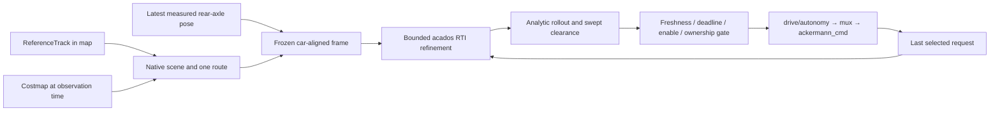

# CPU MPC prototype

This prototype follows a Frenet raceline while predicting Cartesian bicycle motion, repairs one route around static costmap obstacles, and optimizes speed and steering with generated acados C code. It runs up to three bounded SQP-RTI linearizations per feedback cycle, stopping early when residuals meet the refinement threshold. There are no opponents, background maneuver proposals, actuator dynamics, delay compensation, GPU backend, or physical-car launch.

The original implementation is on `feature/mpc-prototype`. The AutoDRIVE integration is on `feature/mpc-autodrive`; use the repository root checkout for its build and commands.

See the [agreed plan](../../../documentation/mpc-protoype-plan.md) and [measured results and limits](../../../documentation/mpc-prototype-results.md). The implemented controller is a small tracking MPC with local route repair, rather than the full proposed MPCC architecture with optimized progress and maneuver alternatives.

## Build

Verified here with Ubuntu 24.04, ROS 2 Jazzy, Python 3.12, CasADi 3.8.1, and acados `988136c9ed5871246b9f25005a540600b2daf3d2`. Humble and Jetson builds have not been verified.

Solver dependencies live under `$HOME/.local/opt/wato-mpc`; nothing needs to be installed into `/tmp`. The [dependency script](../../../documentation/install-mpc-dependencies.sh) pins the tested acados revision and installs its template renderer. The installed BLASFEO/HPIPM build uses `GENERIC` CPU kernels; this is not an Orin performance configuration.

After installing dependencies and sourcing your ROS distribution:

```bash
cd /home/what/ros_ws/wato_f1tenth
source /opt/ros/jazzy/setup.bash
colcon --log-base log-ros build --build-base build-ros --install-base install-ros \
  --packages-up-to mpc_controller --cmake-args -DCMAKE_BUILD_TYPE=Release \
  -DMPC_CONFIG="$PWD/src/robot/mpc_controller/config/prototype.json"
source install-ros/setup.bash
```

Use the system Python for `colcon` and ROS tests; the dependency virtual environment is only used by solver generation. CMake invokes that interpreter directly. Override `MPC_DEPS_ROOT`, `ACADOS_ROOT`, or `MPC_PYTHON` through CMake if your installation is elsewhere. The built executables embed the solver library path.

## Run the matching-model simulation

In the built and sourced worktree:

```bash
ros2 launch mpc_controller prototype.launch.py scene:=obstacle
```

Choose `solo`, `obstacle`, or `blocked`. The fixture publishes a map-matched reference with widths, a native occupancy grid, and rear-axle odometry; it applies selected speed and steering instantaneously with an independent analytic bicycle rollout. The track is a radius-10 m circle with 3 m widths on either side. The obstacle intersects the initial raceline; `blocked` places a wall across it. This fixture has no rendering window; inspect `/odom`, `/mpc/predicted_path`, `/mpc/status`, and `/mpc/ground_truth_clearance` through ROS tools or RViz.

Autonomy starts disabled. In another terminal:

```bash
source /opt/ros/jazzy/setup.bash
source /home/what/ros_ws/wato_f1tenth/install-ros/setup.bash
ros2 topic pub -r 20 /dead_man_switch std_msgs/msg/Bool '{data: true}'
```

Stopping this publisher removes the enable heartbeat; the node requests zero speed after at most 150 ms plus callback scheduling. To disable immediately:

```bash
ros2 topic pub --once /dead_man_switch std_msgs/msg/Bool '{data: false}'
```

The mux gives emergency, joystick, and keyboard commands priority over autonomy. Run only one autonomy publisher. A failed, expired, stale, or unvalidated cycle publishes a fresh zero-speed/zero-steering request. The fixture independently clears selected commands after 60 ms without a command. Its zero-speed stop is verified for the instantaneous-command plant only.

## Tests and benchmarks

Standalone C++ tests and closed-loop benchmarks do not require ROS:

```bash
cmake -S src/robot/mpc_controller -B build-offline -DMPC_BUILD_ROS=OFF
cmake --build build-offline --parallel 4
ctest --test-dir build-offline --output-on-failure
build-offline/mpc_benchmark solo 10000
build-offline/mpc_benchmark obstacle 10000
build-offline/mpc_benchmark blocked 2000
```

Each simulated cycle represents 20 ms, independently of how quickly the benchmark executes. The benchmark includes scene rebuilding every fifth cycle, preparation, solver updates/execution/extraction, independent validation, and command selection. It excludes ROS callbacks, serialization/publication, mux transit, and other autonomy processes. Rejected solves apply a stop; approval rate matters alongside timing. Long runs check lap progress and obstacle passage as well as clearance.

For live ROS checks, after building and sourcing:

```bash
ROS_LOG_DIR="$PWD/log-ros/runtime" python3 src/robot/mpc_controller/test/test_runtime.py
colcon --log-base log-ros test --build-base build-ros --install-base install-ros \
  --packages-select local_planning --ctest-args -R test_raceline_reference --output-on-failure
```

The live tests use an isolated ROS domain and real controller, mux, fixture, costmap, and simulator bridge processes. They check enable/disable, heartbeat loss, stale state/grid, manual/emergency priority, solver stall, paused/rewound simulation clocks, scan timestamps/invalid rays, and stale throttle clearing. The script prints a short ROS-cycle timing and resident-memory sample. These are functional smoke tests, not a thermal or shared-autonomy benchmark.

## Runtime and interfaces



One controller process owns one solver workspace. A single worker executes scene preparation and optimization; two ROS executor threads service input and scheduling/watchdog callbacks. The worker is not a background maneuver search. Jobs do not queue: a busy worker causes a stop. The 20 ms release-to-publication deadline includes scene construction when necessary. A separate 5 ms watchdog can issue stop requests while the worker is stalled, and the publication gate rejects late results.

| Input/output | Contract |
|---|---|
| `/global_planner/reference_track` | Reliable, transient-local `global_planner/ReferenceTrack`, in `map`. Existing encoding: `path.poses[i].pose.position.z` is speed guidance in m/s, not elevation. Widths in m are index-aligned. Optional `legal_boundaries[2]` are implicitly closed, simple, disjoint, nested paths in `map`; supply both or neither. When supplied, these loops define the legal annulus instead of width offsets. Rebuild all ROS message consumers after this schema change. Geometry is static until replaced; replacement resets association and warm starts. Frame names do not prove map identity: the supplied reference must match the scene. |
| `/odom` | `nav_msgs/Odometry` with `child_frame_id` equal to `vehicle_frame` (default `base_link`), finite planar pose and finite measured longitudinal speed. Transform at its observation timestamp to `map`; apply configured `rear_axle_offset_x_m`. The default offset is 0 for the fixture. No propagation or state filtering. |
| `/costmap` | `nav_msgs/OccupancyGrid`, native axes, origin, resolution, cells, and observation timestamp retained. Transform its origin into `map` at that timestamp. Occupancy >=50, unknown, outside-grid, and outside-track space are blocked. |
| `/dead_man_switch` | `std_msgs/Bool`, true heartbeat at least every 150 ms; false disables immediately. Default disabled. |
| `/ackermann_cmd` | Mux-selected request. A bounded own-request history distinguishes autonomy echoes from takeover; missing selected history inhibits motion. New selected requests invalidate in-flight jobs. |
| `/drive/autonomy` | `AckermannDriveStamped`: speed in m/s, steering in rad, fresh publication stamp. The actual float32 payload is independently validated before publication. |
| `/mpc/predicted_path` | Validated solution in `map`; visualization only. |
| `/mpc/status` | Approval or rejection reason, including publication-gate failures. A stopped command is not counted as an approved optimization. |

`/mpc/metrics` is a prototype `Float64MultiArray`: indices 0–8 are release-to-publication elapsed ms, preparation ms, solver update/solve/extraction ms, validation ms, published approval (0/1), minimum covering-circle clearance m, cycle sequence, state observation age s, and grid observation age s. Index 0 also includes scene rebuilds and path/status publication. It does not include DDS delivery to subscribers or mux/actuator application. Infinity clearance means no validated clearance was computed.

State and grid snapshots retain both ROS observation timestamps and steady-clock receipt times. Both must remain fresh at publication: defaults are 60 ms for state and 200 ms for grid. Replayed/non-increasing timestamps cannot renew freshness. A backward ROS-clock jump clears input and selected-command history and resets the controller; subsequent fresh inputs can bootstrap again. Enable expiry, manual ownership, track/grid versions, selected-command version, and job identity are rechecked under the publication mutex.

Core values use SI units and doubles; `Pose` is `(x,y,yaw)`. `Problem` owns fixed arrays: 31 local targets, 30 speed targets, `31×4` normalized corridor half-planes, `31×5` seed states, and 30 command pairs. State order is `[X,Y,psi,previous_requested_speed,previous_requested_steering]`; the final two are command memory. `Solution` owns `31×5` solver states, 30 command pairs, frozen map-to-local frame, versions, residuals, and timing. `Reference` and `Grid` snapshots are immutable shared owners in ROS jobs; `Scene` references its owning reference and caches masks for one grid/reference version. No ROS node, plugin system, or universal expression layer is introduced for these internal boundaries.

## Numerical problem and geometry limits

The physical dynamics are `Xdot=v*cos(psi)`, `Ydot=v*sin(psi)`, `psidot=v*tan(delta)/L`. Controls are requested speed and steering. RK4 predicts 30 intervals of 40 ms; feedback runs every 20 ms. Initial physical state is exactly `(0,0,0)` in a frame frozen at the latest received rear-axle pose. Each numerical state also remembers the previous requested command for change penalties/limits. An independent analytic constant-curvature integrator validates the actual command sequence, including motion between stages and the translational plus rotational motion of the disk center.

Running least-squares residuals are position error, unwrapped heading error, speed error, adjacent speed/steering request change rates, and steering magnitude. Diagonal weights are `[20,20,2,3,.05,.03,.01]`; acados scales running costs by the 40 ms interval. The terminal position/heading weights are `[20,20,2]`. These are provisional tuning values with mixed SI units, not validated racing-optimal weights. Bounds are hard: speed `[0,1]` m/s; steering derived from the inspected servo configuration in `prototype.json`, approximately `[-.308199,+.268644]` rad (the explicit AutoDRIVE profile uses ±0.5236 rad); request-change rates <=2 m/s² and <=2 rad/s. The last requested speed is zero. These request limits and the terminal request do not describe actuator lag or guarantee a real stopping distance.

Geometry remains the existing periodic cubic raceline on cumulative straight-segment-length station. `parameter_speed` converts physical sampling increments to station increments. Caller-owned unwrapped projection association, heading, plausible displacement, and lap wrapping prevent accidental branch jumps; invalid association stops and resets. The optimizer receives extracted positions/headings and four faces per stage, not spline coefficients or grid cells.

Without explicit legal loops, the track is reconstructed from sampled offset boundaries, including every width-lookup knot and smaller adjacent widths. Explicit loops are checked for finite vertices, self/inter-loop intersection, nesting, and containment of reference waypoints before replacing a reference. A shared reference fix retains narrow original waypoint widths between lookup samples. There is a 5 mm geometric/raster tolerance. **The 5 cm station sampling and this tolerance are validated on the supplied circle fixture, not analytically certified for arbitrary tracks.** Offset folds are rejected, but global boundary simplicity/map alignment are not proved. Validate a new map's reconstructed legal mask against a denser independent boundary before using it; self-intersecting/ambiguous tracks remain unsupported.

Occupied, unknown, and illegal cells are inflated by a disk covering the entire vehicle body plus clearance and raster margins. The disk is centered 0.15 m ahead of the rear axle, with radius `hypot(0.30,0.14)` ≈0.331 m; state and reference positions remain at the rear axle. Solver faces constrain this yaw-dependent disk center. Prefix-sum row stencils conservatively account for distances between full cell squares. When that mask rejects a continuously safe pose, a small fallback box is certified from original geometry distances with a Lipschitz bound; no occupancy is cleared. Reported clearance is capped at 0.15 m, the searched-distance bound. Provisional body dimensions are front 0.45 m, rear 0.15 m, half-width 0.14 m relative to the rear axle; clearance is 0.05 m. The body-covering disk remains more conservative than the oriented body, especially in very narrow passages. The one A* repair additionally leaves 0.20 m seed clearance to give corner rounding room; this is deterministic geometric padding, not uncertainty modeling. These choices can reject a physically traversable narrow passage.

One bounded 8-neighbor A* search, without diagonal corner cutting, supplies one route when the forward reference is blocked. Line-of-sight reduction keeps checked shortcuts for grid routes and off-line rejoins; a clear reference near the raceline retains its curvature. Passed segments are retired by segment projection. Stage rectangles are anchored on a safe seed rollout where available, with route targets used otherwise. This prevents route timing from becoming a hard requirement to reach a sharp corner. Future solver faces are contracted by up to 2 mm, capped at half the seed slack to preserve a feasible stopped seed; the measured initial stage is not contracted. Corridor endpoint checks alone never authorize motion: original grid-cell squares and the reconstructed track are checked along analytic motion with a sampling-distance allowance. A feasible scene can still cause stops when this single route, conservative corridor, or three RTI linearizations are inadequate. Cold starts use a braking rollout; failed solver states reset the workspace.

Capacities: <=20,000 reference points, <=2,000 m chord-station length, <=40,000 dense boundary samples plus width knots per side, <=1000×1000 grid with 0.01–1 m resolution, <=12,000 A* expansions and deadline checks during search/reduction. Malformed or excessive inputs reject, rather than crop away hazards. Scene and repair scratch allocations are bounded but not allocation-free; the generated solver itself keeps a persistent workspace. Reference fitting occurs on reference updates, scene masks on grid/reference changes, and stage references/parameters/warm guesses each feedback cycle. This is not a certified worst-case execution-time implementation.

`MPC_CONFIG` selects the build-time model/horizon/body/limit source, defaulting to `config/prototype.json`; AutoDRIVE uses `config/autodrive.json`. The node checks the requested `model_profile` against the generated profile to prevent launching the wrong solver. Changing it or `tools/generate_solver.py` regenerates derivatives and solver C code at configure time and recompiles; restart the node afterward. Track/grid/reference values and per-stage targets/faces are numerical updates, with no solver regeneration. A changed track, ownership/history loss, or clock reset clears association/warm starts. Cold/infeasible RTI results can be rejected; constraints are never softened to obtain an approval.

## Installed Porto AutoDRIVE scene

See [AutoDRIVE setup and measured results](../../../documentation/mpc-autodrive.md). The installed Unity binary is Porto; the previously requested Mexico City assets do not match it.

```bash
bash documentation/run-mpc-autodrive.sh build
bash documentation/run-mpc-autodrive.sh api
bash documentation/run-mpc-autodrive.sh run
# Another terminal, after connecting Unity and selecting Autonomous:
bash documentation/run-mpc-autodrive.sh trial --seconds 180 --require-laps 1 \
  --output log-autodrive/my-trial.json
```

Use `drive` instead of `trial` for a continuous enable heartbeat; Ctrl-C removes it. Run only one enable publisher. The commands file pins the locally tested API image and configures host UDP DDS for Docker/WSL interoperability. Native rear-axle odometry and native LiDAR/TF replace the older fake odometry/remapping wiring.

The inherited bridge divides requested speed by 22.88 to request throttle and steering by 0.5236. This is an approximate low-speed conversion, not instantaneous physical speed control. A 60 ms receipt watchdog clears stale throttle requests; zero throttle can coast. Simulator measurements, physical-car limitations, and remaining performance work are recorded in the linked results. No physical-car trial or Orin 20 ms shared-workload guarantee is established.
